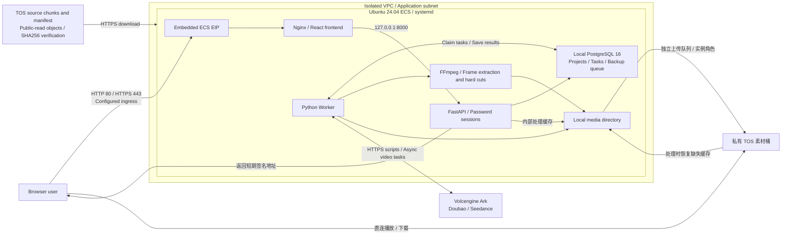

# AI Script and Video Creation Studio on Volcengine

English | [简体中文](README.zh-CN.md)

This template uses Terraform and `volcengine/volcenginecc` to create networking, ECS, TOS, and an instance role on Volcengine. It automatically deploys a single-user studio with multiple projects, built with React, FastAPI, a Python Worker, PostgreSQL, and FFmpeg. Users can turn story ideas into scripts and storyboards, generate videos shot by shot with reference assets, and assemble and download the final film.

## 1. Business Background

Short video production involves story development, storyboard design, visual generation, and editing. Working directly with separate model APIs introduces several challenges:

- **Fragmented creative workflow**: scripts, prompts, clips, and final films are stored separately, making revisions difficult to track.
- **Inconsistent shots**: character appearance, clothing, positions, and actions can change between shots, or the next shot may repeat the previous action.
- **Difficult asynchronous task management**: cloud video generation takes time, and interrupted connections, moderation failures, or failed downloads can lead to duplicate submissions.
- **Incomplete asset retention**: temporary video URLs without persistent assets and task records make it difficult to resume editing or investigate failures.

This solution brings project settings, structured storyboards, model tasks, reference assets, video archiving, and film export into one studio. Users review shots before manually generating videos and can use the previous shot's out-point frame to help maintain continuity.

## 2. Solution Overview

- **Network and compute**: an isolated VPC, one `/24` application subnet, a security group, and an Ubuntu 24.04 ECS instance with an embedded public EIP. Nginx serves the frontend and reverse proxy; parameters control Web and SSH ingress.
- **Application and database**: a React/TypeScript frontend, FastAPI API, and separate Python Worker. PostgreSQL 16 runs on ECS and stores projects, shots, tasks, leases, and the backup queue. API and database ports are not exposed publicly.
- **Models**: Doubao 2.1 generates scripts and Seedance 2.0 generates videos by default. Projects can select other enabled models or inference endpoints. The template configures model IDs but does not create Ark endpoints or API keys.
- **Delivery**: Terraform encodes source code and the prebuilt frontend into 16 KiB TOS chunks, then publishes a verification manifest after all chunks are uploaded. ECS downloads, combines, and verifies the content before installing native services managed by systemd.
- **素材与成片**：私有 TOS 保存最终素材，浏览器通过短期签名地址直连访问。ECS 本地文件用于暂存、选帧和拼接，独立上传队列负责持久化，缺失缓存可从 TOS 恢复。



Creative workflow: **create a project → generate a script → edit and confirm shots → generate each shot → review visuals and continuity → assemble the film → preview or download MP4**. Storyboards can be exported as JSON; projects can be created, switched, searched, archived, and restored.

The default model IDs are `doubao-seed-2-1-pro-260628` and `doubao-seedance-2-0-260128`, with the Ark API at `https://ark.cn-beijing.volces.com/api/v3`. Confirm availability and model permissions in the target account before deployment. Generation and regeneration incur model usage charges; saving settings and previewing prompts do not invoke models.

## 3. IaC Design

### 3.1 Resource Inventory

Cloud resources use `volcengine/volcenginecc = 0.0.73`; Terraform must be `>= 1.5.7, < 2.0`. The destruction delay uses `hashicorp/time = 0.14.2` and `time_sleep`, without local command execution.

| Terraform resource | Count | Purpose |
| --- | ---: | --- |
| `volcenginecc_vpc_vpc.app` | 1 | Isolated VPC |
| `volcenginecc_vpc_subnet.app` | 1 | Application `/24` subnet |
| `volcenginecc_vpc_security_group.app` | 1 | SSH, HTTP, and HTTPS source restrictions |
| `volcenginecc_ecs_instance.app` | 1 | Pay-as-you-go CPU ECS, system disk, primary NIC, EIP, and role association |
| `volcenginecc_tos_bucket.assets` | 1 | Private media bucket with versioning enabled by default |
| `volcenginecc_tos_bucket_cors.assets` | 0 or 1 | CORS when exact allowed origins are configured |
| `volcenginecc_iam_policy.assets` | 1 | Listing and object read/write/delete permissions scoped to the media bucket |
| `volcenginecc_iam_role.app` | 1 | ECS trust and required runtime policies |
| `volcenginecc_iam_policy.delivery` | 0 or 1 | Read access to specified private source archives or Ark key objects |
| `volcenginecc_tos_bucket.source` | 0 or 1 | Separate source bucket for automatic delivery |
| `volcenginecc_tos_object.source_parts` | N | Automatic source chunks, each no larger than 16 KiB |
| `volcenginecc_tos_object.source` | 0 or 1 | Verification manifest published after all chunks |
| `time_sleep.eni_release_wait` | 1 | Destroy-only delay after ECS deletion and before security group deletion |

N depends on source and frontend build size; use the execution plan and `source_delivery.chunk_count` for the actual count. The EIP, system disk, primary NIC, and role association are embedded ECS settings, not separate resources. The ECS installer creates PostgreSQL, database accounts, the Web login password, and application services.

Delivery modes:

| Configuration | Behavior |
| --- | --- |
| `auto_source_upload = true`, `source_release = null` | Default: Terraform uploads chunks and starts the application |
| Set `source_release` | Use an existing private TOS release archive; takes precedence over automatic upload |
| `auto_source_upload = false`, `source_release = null` | Create infrastructure and base host configuration without installing application source |

Both source and media buckets have private bucket ACLs. Only automatically delivered source chunks and manifests are public-read; they must contain no credentials or business media. The Ark key is supplied through a separate private object reference or a host file after deployment; the template does not accept the key value. In password login mode, `ecs_password` is stored in Terraform state and plans, so protect state storage.

### 3.2 Project Structure

```text
.
├── backend/
│   ├── app/                     # API, Worker, model adapters, media processing and backup
│   └── requirements.txt
├── frontend/
│   ├── src/                     # React/TypeScript studio
│   ├── dist/                    # Build output required before automatic delivery
│   ├── nginx.conf
│   └── nginx-public.conf
├── scripts/
│   ├── package-release.py       # Build frontend and create a complete release bundle
│   ├── ecs-bootstrap.sh         # ECS installation entry point
│   ├── ecs-deploy.py            # Download, combine and verify source
│   ├── ecs-native.py            # Install database and systemd services
│   └── ecs-public-web.py        # Configure Nginx and test HTTPS
├── main.tf                      # Networking, ECS, media bucket and IAM
├── delivery.tf                  # Source encoding, chunks and manifest
├── bootstrap.tf                 # Runtime configuration and cloud-init
├── variables.tf
├── outputs.tf
├── versions.tf
├── providers.tf                 # Provider configuration
├── terraform.tfvars             # Local deployment parameters
├── compose.yaml                 # Optional local container setup
├── compose.dev.yaml
├── README.md                    # English documentation
└── README.zh-CN.md               # Chinese documentation
```

This release directory includes prebuilt `frontend/dist/` for direct deployment and a tracked `terraform.tfvars` containing the current target environment's parameters. Review these parameters for the target account before deployment, and rebuild the frontend after changing its source. `terraform.tfvars` remains excluded from automatic source archives, while state, plans, `.env`, `secrets/`, `config/runtime.json`, `data/`, and `work/` remain excluded from both Git and those archives. Deployment and operations are covered in section 4.

### 3.3 Key Code Examples

[delivery.tf](delivery.tf) encodes runtime files and splits the payload into small objects. The manifest records the encoded size, chunk count, and checksums. Key fields of the manifest resource are shown below:

```hcl
resource "volcenginecc_tos_object" "source" {
  count      = local.auto_delivery ? 1 : 0
  bucket     = volcenginecc_tos_bucket.source[0].name
  key        = "releases/${local.source_payload_sha256}/manifest.json"
  content    = local.source_manifest
  public_acl = "public-read"
  depends_on = [volcenginecc_tos_object.source_parts]
  # The full configuration also sets content type, encryption, tags and size preconditions.
}
```

[bootstrap.tf](bootstrap.tf) writes the manifest location, manifest SHA256, and source SHA256 into the deployment configuration. ECS downloads chunks in order and verifies the manifest, chunk lengths, combined payload, and decompressed source before installing the application. Encoded content is limited to 10 MiB and decompressed JSON to 100 MiB. Legacy single-object delivery and private `.tar.gz` releases remain supported.

Creation dependencies are `security group → time_sleep.eni_release_wait → ECS`; destruction runs in reverse, with a default 120-second delay to allow asynchronous NIC detachment. No creation delay is configured, and destruction does not invoke Python or shell commands. The wait resource must have been applied to state before a later destroy can execute it.

For an existing stack with the previous `terraform_data` wait resource, review a fresh plan before applying: the old wait resource is removed and the new `time_sleep` resource is added. Do not use a `moved` block to change between these resource types. Confirm that ECS is not replaced and apply the new wait resource before destroying the stack. Removing the old resource block also removes its destroy provisioner, so it cannot provide the previous delay during the transition.

Chunks use Terraform's default parallelism without an additional global concurrency limit. Chunking addresses large `Content` payloads, but CCAPI read-back `Resource Not Found` errors have still been observed during concurrent creation or refresh. Chunking does not resolve that cloud-side issue. Section 4 covers deployment and verification.

## 4. Usage

Deploy a complete template through InfraManager, or use local Terraform to install the same native ECS services. For InfraManager, confirm support for both selected provider versions. InfraManager acceptance testing has not yet been completed. This release includes deployment scripts; development helpers and automated tests remain in the development repository.

### 4.1 Cloud Deployment

#### 4.1.1 Prepare Permissions

The stack execution identity needs CloudControl access and permissions to manage and associate VPCs, subnets, security groups, ECS instances, disks, NICs, EIPs, TOS resources, and IAM roles/policies, including passing a role to ECS. The application uses the instance role created by the template to access specified buckets or objects; deployment and runtime identities serve different purposes.

Prepare an Ubuntu 24.04 amd64 image, an available CPU ECS instance type, EIP and disk quotas, and a globally unique media bucket name in the target region. A starting capacity of 4 vCPU / 8 GiB is recommended; actual requirements depend on generation concurrency, video archiving, and FFmpeg load.

Enable the script and video models in the [Volcengine Ark console](https://console.volcengine.com/ark) and create an API key authorized to invoke them. An Ark key differs from cloud account AK/SK credentials, model IDs, and `ep-...` endpoint IDs. Supply it using either method:

- Store the single-line Ark key in an existing private TOS object and configure its bucket, region, endpoint, and object key in `ark_secret_source`. Terraform stores only the reference.
- After deployment, use the ECS management terminal to write `/opt/ai-animation/secrets/ark_api_key` and keep its permissions at `0600`.

ECS needs outbound access to TOS, Ubuntu package repositories, the Python package index, and Ark HTTPS APIs. Native installation uses `https://mirrors.ivolces.com/pypi/simple/`. The frontend is built on the release machine; ECS does not need npm or Docker.

#### 4.1.2 Select the Template

Import a complete release bundle containing the root Terraform files, `scripts/`, backend source, Nginx configuration, and `frontend/dist/` into the [InfraManager console](https://console.volcengine.com/iac). This project is not assumed to be available as a published public template.

On a release machine with Node.js/npm and Python 3, run:

```bash
npm --prefix frontend ci
python3 scripts/package-release.py --version v2026.11.06-native
```

The script builds the frontend and writes a `.tar.gz` archive, SHA256 checksum, metadata, and a private release parameter example to `releases/`. The archive excludes local `terraform.tfvars`, state, plans, `.env`, secrets, and media data. It generates a file integrity manifest inside the archive for the installer. Supply deployment parameters separately as described in section 4.2.1. Organize files according to the platform's supported import format and preserve relative directory paths.

#### 4.1.3 Create a Stack

Create a stack from the imported template and enter the parameters in section 4.2.1. Required inputs are `zone_id`, `image_id`, `instance_type`, `bucket_name`, `ssh_allowed_cidrs`, and the ECS credentials for the selected login mode.

For the default key-pair mode, provide an existing `ssh_key_pair_name`. For password mode, leave the key-pair name empty and supply `ecs_password` as a sensitive parameter. Public ports 80/443 open only when `web_allowed_cidrs` is configured; an empty set retains SSH tunnel access. Do not put AK/SK credentials or the Ark key value in template parameter files.

Review chunk counts, bucket names, allowed CIDRs, role permissions, and any deletions or replacements in the plan before deployment. A successful Terraform run or stack operation confirms resource creation; application download and installation may still be running.

#### 4.1.4 Verify the Deployment

Locate ECS using `infrastructure.instance_id`. Run these commands in its console terminal or an SSH session:

```bash
sudo cloud-init status
sudo cat /opt/ai-animation/deployment-status.json
sudo systemctl is-active ai-animation-api.service ai-animation-worker.service nginx.service
curl --fail --silent --show-error --max-time 15 http://127.0.0.1:8080/api/health
```

When ready, the deployment status `phase` is `ready`, the three persistent services are `active`, and the health endpoint returns `{"status":"ok"}`. `ready_without_ark_key` means the website is running but the model key has not been configured. A nonempty key file does not verify model permissions through a real invocation.

If installation fails, inspect status and logs:

```bash
sudo systemctl status ai-animation.service ai-animation-api.service ai-animation-worker.service nginx.service --no-pager
sudo journalctl -u ai-animation.service -u ai-animation-api.service -u ai-animation-worker.service -n 100 --no-pager
```

After entering or updating the Ark key in an editor, restart the installer service so that API/Worker services reload their systemd credentials:

```bash
sudoedit /opt/ai-animation/secrets/ark_api_key
sudo chmod 600 /opt/ai-animation/secrets/ark_api_key
sudo systemctl restart ai-animation.service
```

If `ark_secret_source` is configured, update the corresponding private object or version reference to prevent installation retries from reloading the old value. Keep secrets out of command arguments and logs.

Read the studio login password in a controlled terminal:

```bash
sudo cat /opt/ai-animation/secrets/owner_password
```

Open `application_access.public_http_url` or `public_https_url` and sign in with that password. The Web password differs from ECS login credentials. HTTPS initially uses a self-signed test certificate valid for one year. For trusted domain access, replace `/etc/nginx/ssl/ai-animation/tls.crt` and `tls.key`, then check and reload Nginx.

If public Web ingress is disabled, use `application_access.ssh_tunnel_command` and open `http://127.0.0.1:8080`. Choose a different local forwarding port if another application already uses it.

Application acceptance checks:

1. Create a test project, configure the idea, two characters, duration, aspect ratio, and models, then generate and review a structured script.
2. Generate the first shot and confirm playback. In the next shot's reference assets panel (“参考素材”), extract and preview the previous shot's out-point frame, save the configuration, and manually start generation.
3. Check continuity of characters, clothing, actions, and sound. Once all shots are ready, assemble the film, then play and download the MP4 from “我的成片” (My Films).
4. Inspect task status, the Ark Task ID, and failure diagnostics in task history. Confirm that videos and reference frames show “已备份到云端” (Backed up to cloud).
5. Restart API/Worker and confirm that projects and assets remain accessible. Handle moderation rejections using the actual error; an accepted request does not mean a video was successfully generated.

### 4.2 Local Deployment

Run the following Terraform commands from this project's root directory in WSL/Linux to deploy cloud resources. Run ECS status checks and secret configuration commands in the ECS terminal.

#### 4.2.1 Prepare the Environment

Install Terraform `>= 1.5.7, < 2.0` and prepare a deployment identity with access to Volcengine APIs. This release includes `frontend/dist/` and does not require a frontend build before deployment. Python 3 and Node.js/npm are needed for release packaging. Provider versions are pinned in `versions.tf`, with configuration in `providers.tf`; `terraform init` generates the dependency lock file.

Provide `VOLCENGINE_ACCESS_KEY` and `VOLCENGINE_SECRET_KEY` through environment variables or the provider credential chain; temporary credentials also require `VOLCENGINE_SESSION_TOKEN`. In password mode, inject the system password through `TF_VAR_ecs_password`. Keep real credentials out of source code, command history, and version control.

Review the local `terraform.tfvars` and update values for the target account. When using an archive without this file, create it from the parameters below. Defaults come from [variables.tf](variables.tf) and may differ from the local environment's configured values:

| Parameter | Default / input | Description |
| --- | --- | --- |
| `region` / `zone_id` | `cn-beijing` / required | Region and an availability zone with capacity |
| `project_name` / `name_prefix` | `default` / `ai-animation` | Cloud project and resource name prefix |
| `tags` | `{}` | Additional tags |
| `vpc_cidr` | `10.42.0.0/16` | Derives the first nonzero `/24` subnet, `10.42.1.0/24` by default |
| `image_id` | Required | Ubuntu 24.04 amd64 image with cloud-init enabled |
| `instance_type` | Required | Available CPU ECS type; start with 4 vCPU / 8 GiB |
| `ecs_login_mode` | `key_pair` | `key_pair` or `password` |
| `ssh_key_pair_name` | `null` | Existing key-pair name required in key-pair mode |
| `ecs_password` | `ReplaceWithStrongPassword123`, sensitive | Public example default; replace for real password login, set explicitly to `null` for key-pair login |
| `ssh_allowed_cidrs` | Required | Nonempty set of administrator IPv4 CIDRs |
| `web_allowed_cidrs` | `[]` | Allowed sources for 80/443; empty disables public Web ingress |
| `system_disk_size_gib` / `system_disk_type` | `100` / `ESSD_FlexPL` | System disk size and type; at least 40 GiB |
| `delete_system_disk_with_instance` | `true` | Delete the system disk with ECS; set to `false` to retain it and continue billing |
| `deletion_protection` | `false` | Cloud-side ECS deletion protection |
| `eni_release_wait_seconds` | `120` | Wait for NIC release after ECS deletion; 0–900 seconds |
| `public_bandwidth_mbps` | `10` | Bandwidth cap for the traffic-billed EIP |
| `bucket_name` | Required | Globally unique private media bucket name |
| `bucket_versioning` | `Enabled` | Media bucket versioning; also supports `Suspended` |
| `cors_allowed_origins` | `[]` | Exact browser origins; empty skips CORS creation |
| `auto_source_upload` | `true` | Terraform automatically uploads source chunks and the manifest |
| `source_release` | `null` | Existing private source archive reference; overrides automatic upload |
| `ark_secret_source` | `null` | Existing private Ark key object reference: bucket, region, endpoint, and object key |
| `ark_base_url` | `https://ark.cn-beijing.volces.com/api/v3` | Ark API base URL |
| `script_model_id` | `doubao-seed-2-1-pro-260628` | Default script model; can be overridden per project |
| `video_model_id` | `doubao-seedance-2-0-260128` | Default video model; can be overridden per project |
| `application_compose_path` | `null` | Cloud Compose mode has been removed; leave null |

Login credentials are mutually exclusive: provide only the key-pair name in key-pair mode and only the password in password mode. Automatically loaded `terraform.tfvars` values take precedence over `TF_VAR_*`. When injecting the password through an environment variable, remove any `ecs_password` assignment from the parameter file, including `ecs_password = null`.

#### 4.2.2 Scenario-based Deployment Examples

If frontend source has changed, rebuild it before initializing Terraform; the first two commands can be skipped when using the unchanged prebuilt release:

```bash
npm --prefix frontend ci
npm --prefix frontend run build
terraform init -input=false
terraform fmt -check
terraform validate
```

**Scenario 1: automatic source upload and ECS key-pair login.** After filling in all required parameters, set the following in `terraform.tfvars`:

```hcl
auto_source_upload = true
source_release     = null
ecs_login_mode     = "key_pair"
ssh_key_pair_name  = "your-existing-key-pair"
ecs_password       = null
```

```bash
terraform plan -out=deploy-chunks.tfplan
terraform show deploy-chunks.tfplan
terraform apply deploy-chunks.tfplan
```

One apply creates infrastructure, uploads chunks of the current source, and triggers ECS installation. Commands use Terraform's default parallelism. Do not reuse an old plan created before changing the template.

**Scenario 2: existing private release archive and ECS password login.** Create a source archive with the release script, upload it to an existing private delivery bucket, and use the full SHA256 from the script output:

```hcl
ecs_login_mode    = "password"
ssh_key_pair_name = null
# Supply ecs_password through TF_VAR_ecs_password or a sensitive platform parameter.

source_release = {
  bucket     = "your-existing-delivery-bucket"
  region     = "cn-beijing"
  endpoint   = "https://tos-cn-beijing.volces.com"
  object_key = "releases/<version>/<sha256>/<archive>.tar.gz"
  sha256     = "<64-character-lowercase-SHA256>"
}
```

```bash
terraform plan -out=deploy-private.tfplan
terraform show deploy-private.tfplan
terraform apply deploy-private.tfplan
```

This mode does not create an automatic source bucket or chunks. It uses the instance role to read the specified private archive. Both delivery modes support `ark_secret_source` and either login mode. These examples target independent new environments. When changing delivery, login, or bootstrap settings in an existing environment, review replacement actions. Updating user data does not automatically replay cloud-init on an existing host.

#### 4.2.3 Expected Deployment Results

```bash
terraform output
terraform output -json infrastructure
terraform output -json application_access
terraform output -json source_delivery
```

| Output | Description |
| --- | --- |
| `infrastructure` | VPC, subnet, security group, and ECS identifiers, subnet CIDR, and public IP |
| `asset_storage` | Private media bucket, internal/external endpoints, and ECS role TRN |
| `runtime_config` | Non-secret model, storage, role, and Worker settings |
| `application_access` | Public URLs, SSH tunnel, configuration/certificate paths, status and log commands |
| `source_delivery` | Delivery mode, bucket, object key, source SHA256, public manifest URL, and chunk count |

These outputs do not return login passwords or API keys, but this does not mean state contains no sensitive data. Public URL outputs are `null` when Web sources are empty; `source_deploy_enabled` is `false` in infrastructure-only mode.

#### 4.2.4 Post-deployment Verification

Follow section 4.1.4 to check ECS installation, Web login, script and video generation, first-frame continuity, film downloads, and TOS backups. Confirm that the security group permits only configured sources on 22/80/443 and that local database and API ports remain private.

With configuration unchanged, check the plan:

```bash
terraform plan -detailed-exitcode
```

Exit code `0` means no changes, `2` means changes are planned, and `1` means an error. If source objects already exist or read-back returns `Resource Not Found`, inspect cloud objects and state before attempting creation again. Historical checks passed with parallelism set to one, while default parallelism still showed known read errors, as described in section 3.3.

**Converging the default outbound security group rule.** If repeated plans propose deleting the default rule with priority `100` and description “放通全部流量”, include its actual returned attributes in `volcenginecc_vpc_security_group.app.egress_permissions` in `main.tf`, retaining the existing priority `1` rule. The following complete example includes the current rule and the observed default rule. Before applying it, check every field against the actual read-back result, including empty-string fields:

```hcl
egress_permissions = [
  {
    cidr_ip         = "0.0.0.0/0"
    description     = "Allow DNS package downloads and model APIs"
    direction       = "egress"
    policy          = "accept"
    port_start      = -1
    port_end        = -1
    priority        = 1
    protocol        = "all"
    prefix_list_id  = ""
    source_group_id = ""
  },
  {
    cidr_ip         = "0.0.0.0/0"
    description     = "放通全部流量"
    direction       = "egress"
    policy          = "accept"
    port_start      = -1
    port_end        = -1
    priority        = 100
    protocol        = "all"
    prefix_list_id  = ""
    source_group_id = ""
  },
]
```

This example matches existing unrestricted outbound rules and is not suitable for environments requiring outbound restrictions. Avoid hiding the whole collection with `ignore_changes = [egress_permissions]`: it prevents both template changes and cloud rule drift from being used to update existing security groups. If that ignore setting was previously added, remove it when adopting this configuration.

After saving, run `terraform plan -detailed-exitcode`. If the attributes match the refreshed state, this difference should disappear without first applying anything; other real configuration changes still require reviewing the plan. If the default rule is still marked for modification, investigate field normalization and Provider/CCAPI read-back behavior rather than repeatedly applying. The current template does not automatically include this rule; this section provides a manual configuration option.

#### 4.2.5 Destroy Resources

Before destruction, back up PostgreSQL, media, secrets, and runtime configuration. Confirm that the directory, workspace, parameters, and credentials belong to the target environment, then review the deletion plan:

```bash
terraform plan -destroy
terraform destroy
terraform state list
```

The media bucket in the current `main.tf` has `prevent_destroy = false`, and the source bucket has no such protection. Do not rely on Terraform to prevent bucket deletion. Runtime media uploads are not separate Terraform resources. Nonempty buckets, historical versions, or delete markers may block deletion and require handling according to the agreed retention plan. Having a backup does not mean its bucket can be deleted.

- `delete_system_disk_with_instance = true` deletes the system disk with ECS by default, including its PostgreSQL data, local media, secrets, and runtime configuration. Back up required data before destruction. Set it to `false` to retain the disk and continue billing.
- For an existing ECS instance, changing this setting in `terraform.tfvars` alone does not update the cloud disk policy. Review `terraform plan` and apply the change before destruction; verify that ECS is updated in place without replacement. A destroy operation does not apply a pending disk-policy change. If ECS has already been deleted, handle its retained disk separately instead of running an apply that would recreate the instance.
- Automatically delivered source buckets and objects are managed by the stack. Existing private release archives, external key objects, existing ECS key pairs, and manually created Ark keys are not automatically deleted with it.
- The default NIC release delay is 120 seconds and does not guarantee that cloud detachment has finished. If ECS is already deleted but destruction fails, check NIC and security group associations before continuing destroy. Do not run a full apply that would recreate ECS merely to add a wait resource.
- The delay uses the value already applied to state. Review and apply changes before they can affect a later destroy. If ECS deletion protection is enabled, disable it through a reviewed plan first.
- After completion, check state, remaining console resources, and charges. Empty state does not mean retained disks or external resources have been removed.

### 4.3 Creation, Reference Assets, and Task Recovery

- **Projects and models**: search, archive, and restore projects. Archiving retains assets but disables editing and generation. Project settings support a model catalog or a custom model ID/endpoint. Administrators maintain options in `model_catalog` in runtime configuration; a catalog entry does not establish account permissions.
- **Generation settings**: supported aspect ratios are 16:9, 9:16, 1:1, 4:3, 3:4, and 21:9. Options include 480p/720p/1080p, sound, watermarks, and cloud timeouts of 1–72 hours, defaulting to 48 hours. Fast/mini models do not support 1080p; 1.0 pro requires sound to be disabled. Unknown endpoints need capability mappings.
- **Changes and snapshots**: saving settings does not start generation. Changing video models, aspect ratios, or other output settings retains existing assets and marks them for regeneration. Changing only the script model or timeout does not invalidate videos. Tasks freeze submission settings and reuse the original snapshot during recovery.
- **First-frame continuity**: select first-frame mode in the next shot's reference panel and extract the previous shot's out-point frame on a normalized 24 fps timeline. Review and confirm it; confirmation also saves the previous shot's hard-cut out point. Start the next shot manually. Reconfirm the reference if the upstream video or out point changes.
- **First/last frames and multimodal references**: text-only, first-frame, first/last-frame, and multimodal reference modes are mutually exclusive. First/last-frame mode requires separate starting and target-ending images of the same dimensions, even for the final shot. Images must be PNG/JPEG, no larger than 29 MB each, with sides of 300–6000 pixels and an aspect ratio of 0.4–2.5. First frames must match the project's aspect ratio and use `ratio=adaptive`.
- **Reference video and audio**: multimodal input supports up to 9 images, 3 videos, and 3 audio clips, with no more than 12 assets in total. Each video/audio clip must be 2–15 seconds, with at most 15 seconds total per media type. Audio requires a visual reference and sound enabled. Refer to assets in category order using “图片1” (Image 1), “视频1” (Video 1), and “音频1” (Audio 1).
- **URLs and integrity**: the backend stores images, binds them to SHA256 hashes, and submits them as Base64 within a combined 64 MB request limit. Reference video/audio currently requires long-lived public HTTPS URLs on trusted domains. Temporary signed query parameters and `asset://` URLs are not accepted. Ark further validates actual format, duration, and reachability.
- **Failure diagnostics**: task history (“任务记录”) shows Chinese explanations, cloud error codes, reasons, and Request IDs. Details can be expanded and copied, with manual copying available if clipboard access fails. Full response bodies and secrets are not stored. Historical error details that were never saved cannot be reconstructed.
- **Recovery rules**: tasks with an Ark Task ID resume polling and archiving without resubmission. Resubmitting a definitively terminated task requires confirmation of possible charges. If submission was interrupted without a recorded ID, check Ark and add the existing ID before creating another task. Failed script requests retry automatically at most twice, with a total 10-minute limit and cancellation support.
- **Recovery and storyboard replacement**: active script or composition tasks block recovery of old shot videos; videos for different shots can still queue. Recovery reloads the latest task state after locking and returns 409 for tasks already recovered. Before replacing a storyboard, the Worker checks active old shot tasks and preserves their associations until those tasks are handled.
- **Film export**: FFmpeg normalizes aspect ratio, 24 fps, H.264/AAC, and 48 kHz audio, then joins clips with hard cuts at confirmed out points. When sound is enabled, silent clips receive an audio track. Generated duration and speech may differ from the script; review the final result manually.

### 4.4 Asset Backup and Operational Checks

云端部署默认启用 `storage.auto_upload=true`，私有 TOS 是素材的最终存储。桶名来自 `bucket_name`。上传范围包括新旧镜头视频、成片、模型尾帧、提取的参考帧、上传图片和选帧预览视频。

对象使用 `media/<project_id>/<asset_id>/` 前缀、私有 ACL、AES256 加密和 SDK CRC 校验，上传后通过 HEAD 校验大小与 SHA256 元数据。上传队列与模型任务独立；失败只重试上传，不重新生成视频。重试间隔从 30 秒递增到最多 30 分钟，Worker 中断后可在租约到期后恢复。界面分别显示“已生成”和上传状态，上传成功后才计入“已就绪”并允许拼接、下载。

ECS 通过实例角色获取临时凭证，上传及处理缓存恢复优先使用 TOS 内网 HTTPS 地址。浏览器登录后向 `/api/assets/<asset_id>/access` 获取签名公网地址，再直连 TOS 播放图片、视频或下载；媒体内容不经过后端代理。选帧预览使用 `preview=true`，下载使用 `download=true`。原素材接口保留为签名地址重定向，未登录不能取签名。

签名地址默认有效 900 秒，可通过 `media_url_ttl_seconds` 配置为 60–3600 秒；实际有效期会留出角色凭证到期前的安全余量。前端在地址到期前自动续期，恢复页面可见时也会刷新，续期视频保留播放位置。签名只在响应和浏览器内存中使用，不写入数据库或日志。使用自备临时密钥文件时，管理员仍须及时更新密钥文件。

ECS 本地目录用于生成结果暂存、选帧和 FFmpeg 拼接。内部处理发现缓存缺失时，从已上传的 TOS 对象恢复并校验大小、SHA256；正常播放不读取本地缓存。未启用 TOS 的本地开发继续使用本地文件。开发机启用 TOS 时需配置桶名、地域、内外网地址及后端密钥文件 `TOS_ACCESS_KEY_FILE`、`TOS_SECRET_KEY_FILE`，临时凭证还需 `TOS_SESSION_TOKEN_FILE`。容器部署须将 `MEDIA_ORIGIN` 设置为该桶的完整公网来源（如 `https://<bucket>.tos-cn-beijing.volces.com`），用于网页图片和视频访问策略；原生安装会按运行配置自动设置。

数据库、密钥及运行配置仍需单独备份。ECS 数据目录：

| Data | Path |
| --- | --- |
| PostgreSQL | `/var/lib/postgresql/16/main` |
| Media | `/opt/ai-animation/work/media` |
| Runtime configuration | `/opt/ai-animation/config/runtime.json` |
| Secrets | `/opt/ai-animation/secrets/` |
| Installation status | `/opt/ai-animation/deployment-status.json` |

Operational checks on ECS:

```bash
sudo systemctl is-active ai-animation-api.service ai-animation-worker.service nginx.service
curl --fail --silent --show-error --max-time 15 http://127.0.0.1:8080/api/health
sudo journalctl -u ai-animation-worker.service -n 100 --no-pager
```

Confirm active services and `{"status":"ok"}` from the health endpoint, then inspect backup status in the interface and Worker logs. PostgreSQL advisory locks serialize database migrations. The current schema version is `6`, including task error details and the independent media backup queue.

Verify model permissions, application health, shot continuity, and data recovery in the target environment using section 4.1.4. Automated test suites are maintained in the development repository and are not part of this release.

## 5. Scope and Limitations

This template is intended for AI script and video demonstrations, functional validation, and small personal studios. The application, database, and media share one ECS instance. Multiple replicas, high availability, multi-user authorization, public sharing, monitoring/alerting, and cross-region disaster recovery are not implemented.

- Reference frames and continuity prompts help connect shots but cannot guarantee consistent characters, actions, or voices. AI-generated people may also trigger cloud privacy or copyright moderation; changing text does not guarantee acceptance.
- A selected reference mode does not automatically fall back to text-only generation after a moderation failure. Users review the error and decide what to do next.
- Automatic sequential generation, dissolves, audio crossfades, precise ASR/TTS subtitles, local video/audio uploads for Ark references, and public callback endpoints are not supported.
- The website uses a studio password. Public deployment requires appropriate source restrictions and trusted HTTPS; self-signed certificates are for testing. Model keys come from backend files or private objects and cannot be configured or fully displayed in the website.
- Automatic delivery exposes runtime source code publicly. Manage state, plans, source delivery buckets, media buckets, and retained disks separately. Media backup is not a complete application backup and does not replace recovery drills.
