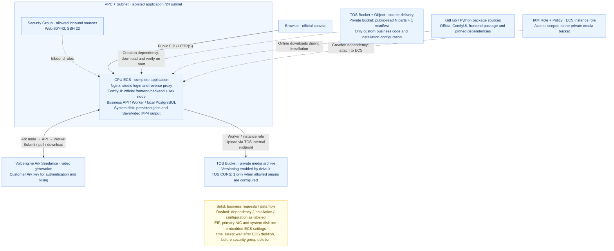

# Self-hosted ComfyUI with Volcengine Ark Video Generation

Enter the customer's Ark key during platform deployment and sign in to the public ComfyUI URL with the studio password. Add the **火山方舟视频生成** node, enter a prompt, select a model and video settings, and click the official Run button. The node returns standard `VIDEO`, previews it on the canvas, and connects to the official `SaveVideo` node for MP4 output.

## 1. Business Background

This template provides a self-hosted ComfyUI canvas and an Ark video node for customers generating Seedance videos through their own Volcengine accounts.

- **Scattered integration steps**: The official canvas, custom nodes, backend and storage require matching configuration. Manual installation can leave components missing.
- **Unclear credentials and billing ownership**: Customers need to manage model permissions, usage and charges in their own Volcengine accounts using their own Ark keys.
- **Difficult recovery of long-running tasks**: Generation, polling, downloading and archiving span several stages. Recovery must reuse existing tasks to avoid duplicate submissions.

Terraform delivers infrastructure and custom source, and ECS installs the services on first boot. Ark keys are loaded through server-side credentials. Official Partner Nodes remain disabled, and the workflow requires no Comfy account or credits.

## 2. Solution Overview

Terraform provisions networking, ECS, TOS and an instance role. First boot downloads and verifies pinned official ComfyUI source, installs its frontend and CPU dependencies, and starts ComfyUI, the backend, Worker and PostgreSQL through systemd. The node calls the backend over local HTTP and reuses durable submission, polling, download, error handling and TOS upload queues.



The current node supports text-to-video with Seedance 2.0, 2.0 fast and 2.0 mini. Duration is 4–15 seconds. Aspect ratios are 16:9, 9:16, 1:1, 4:3, 3:4 and 21:9. The node offers 480p, 720p and 1080p, with fast and mini restricted to 480p or 720p. Parameters are validated against the selected model; actual model availability and permissions depend on the customer's Ark account. [Ark parameter reference](https://docs.volcengine.com/docs/ark/create-video-generation-task-api?lang=zh)

The same generation batch and parameters reuse the business task and Ark Task ID. Change the batch to request a new video. Interrupting the canvas ends node waiting while accepted tasks remain durable. Workflow JSON, node inputs and browser responses exclude the Ark key.

## 3. IaC Design

### 3.1 Resource Inventory

Cloud resources use `volcengine/volcenginecc = 0.0.73`; Terraform must be `>= 1.5.7, < 2.0`. The destruction delay uses `hashicorp/time = 0.14.2` and `time_sleep`, without local command execution.

| Terraform Resource | Logical Name | Count | Purpose |
| --- | --- | ---: | --- |
| `volcenginecc_vpc_vpc` | `app` | 1 | Isolated VPC |
| `volcenginecc_vpc_subnet` | `app` | 1 | Application `/24` subnet |
| `volcenginecc_vpc_security_group` | `app` | 1 | SSH, HTTP, and HTTPS source restrictions |
| `volcenginecc_ecs_instance` | `app` | 1 | Pay-as-you-go CPU ECS, system disk, primary NIC, EIP, and role association |
| `volcenginecc_tos_bucket` | `assets` | 1 | Private media bucket with versioning enabled by default |
| `volcenginecc_tos_bucket_cors` | `assets` | 0 or 1 | CORS when `cors_allowed_origins` is nonempty |
| `volcenginecc_iam_policy` | `assets` | 1 | Listing and object read/write/delete permissions scoped to the media bucket |
| `volcenginecc_iam_role` | `app` | 1 | ECS trust and required runtime policies |
| `volcenginecc_tos_bucket` | `source` | 1 | Separate bucket for automatic delivery of the current custom source |
| `volcenginecc_tos_object` | `source_parts` | N | Automatic source chunks, each no larger than 16 KiB |
| `volcenginecc_tos_object` | `source` | 1 | Verification manifest published after all chunks |
| `time_sleep` | `eni_release_wait` | 1 | Delay after ECS deletion and before security group deletion; creates no cloud resource |

Automatic delivery without CORS creates N + 9 cloud resources and 1 wait object. The current source produces N = 7; the current `terraform.tfvars` example has `cors_allowed_origins = []`, giving 16 cloud resources and 17 Terraform-managed objects. After source changes, use the execution plan and `source_delivery.chunk_count` for N. The EIP, system disk, primary NIC and role association are embedded ECS settings, not separate resources. The ECS installer creates PostgreSQL, database accounts, the Web login password and application services. This project has no data sources or child modules; the deployer supplies the image, a key pair when using key-pair login, the cloud project and Ark model permissions.

Source delivery is always automatic. Users do not select a delivery mode or supply a source download address:

1. Terraform uploads the current template's custom nodes, authentication extension, backend, example workflow and installation configuration to TOS.
2. On first boot, ECS downloads and verifies these business files, then installs and starts the application.

This project does not contain official ComfyUI source, the official frontend package, PyTorch or other runtime dependencies. `scripts/comfyui-release.json` pins the official version, download URLs and checksum; `scripts/comfyui-requirements.txt` and `backend/requirements.txt` pin Python dependencies. ECS downloads and installs them according to these files. No dependency bundle needs to be prepared or uploaded in advance.

Both source and media buckets have private bucket ACLs. Only automatically delivered source chunks and manifests are public-read; they must contain no credentials or business media. The required `ark_api_key` is passed directly as a sensitive Terraform input. The installer writes it to `/opt/ai-animation/secrets/ark_api_key` on ECS with mode `0600`. The key is present in Terraform state, saved plans, and ECS user data; `sensitive` only masks normal display and does not remove the secret from those data stores. In password login mode, `ecs_password` is also present in state and plans.

### 3.2 Project Structure

```text
.
├── backend/
│   ├── app/                     # API, Worker, model adapters, media processing and backup
│   ├── comfyui_extension.py      # Official custom nodes and login protection
│   └── requirements.txt
├── frontend/
│   ├── comfyui-extension/      # Standalone login and CSRF extension
│   │   └── auth.js
│   ├── login/
│   │   ├── index.html
│   │   └── login.js
│   └── nginx/
│       ├── studio.conf
│       └── public.conf
├── scripts/
│   ├── deploy-local.py          # Credential file injection and complete Terraform apply
│   ├── install-comfyui.py       # Verify official source and install CPU dependencies and extensions
│   ├── comfyui-release.json
│   ├── comfyui-requirements.txt # Pinned studio Python dependencies
│   ├── ecs-bootstrap.sh         # ECS installation entry point
│   ├── ecs-deploy.py            # Download, combine and verify source
│   ├── ecs-native.py            # Install database and systemd services
│   └── ecs-public-web.py        # Configure Nginx and test HTTPS
├── main.tf                      # Networking, ECS, media bucket and IAM
├── delivery.tf                  # Source encoding, chunks and manifest
├── bootstrap.tf                 # Runtime configuration and cloud-init
├── variables.tf
├── outputs.tf
├── versions.tf
├── providers.tf                 # Provider configuration
├── terraform.tfvars             # Local deployment parameters
├── compose.yaml                 # Optional local container setup
├── compose.dev.yaml
├── workflows/                   # Ark text-to-video example workflow
│   └── ark-text-to-video.json
├── tests/                       # Local regression tests and fixtures
├── README.md                    # English documentation
└── README.zh-CN.md               # Chinese documentation
```

This project includes business extensions, a login entry point, a pinned component manifest and `terraform.tfvars`. Replace environment parameters before deployment. The official frontend is installed through ComfyUI dependencies without an npm build. `terraform.tfvars`, state, plans, `.env`, `secrets/`, `config/runtime.json`, `data/` and `work/` are excluded from automatic source delivery. Section 4 covers deployment and operations.

`compose.yaml`, `compose.dev.yaml` and Dockerfiles in the component directories support local container development and are not used by the native ECS installation. In section 4.2, local deployment means running Terraform on a local machine to create a cloud environment.

All Terraform resources are defined in the root module. The bootstrap chain is `bootstrap.tf` → `scripts/ecs-bootstrap.sh` → `scripts/ecs-deploy.py` → `scripts/ecs-native.py`. Official ComfyUI is downloaded and installed separately. This project maintains business adapters in `frontend/comfyui-extension/`, `backend/comfyui_extension.py`, and `backend/app/`.

### 3.3 Key Code Examples

`delivery.tf` encodes runtime files and splits the payload into small objects. The manifest records the encoded size, chunk count, and checksums. Key fields of the manifest resource are shown below:

```hcl
resource "volcenginecc_tos_object" "source" {
  count      = 1
  bucket     = volcenginecc_tos_bucket.source[0].name
  key        = "releases/${local.source_payload_sha256}/manifest.json"
  content    = local.source_manifest
  public_acl = "public-read"
  depends_on = [volcenginecc_tos_object.source_parts]
  # The full configuration also sets content type, encryption, tags and size preconditions.
}
```

`bootstrap.tf` writes the manifest location, manifest SHA256, and source SHA256 into the deployment configuration. ECS downloads chunks in order and verifies the manifest, chunk lengths, combined payload, and decompressed source before installing the application. Encoded content is limited to 10 MiB and decompressed JSON to 100 MiB.

Creation dependencies are `security group → time_sleep.eni_release_wait → ECS`; destruction runs in reverse, with a default 120-second delay to allow asynchronous NIC detachment. No creation delay is configured, and destruction does not invoke Python or shell commands. The wait resource must have been applied to state before a later destroy can execute it.

Chunks use Terraform's default parallelism. Section 4 covers deployment and verification.

## 4. Usage

This project supports cloud deployment through InfraManager or local deployment using the downloaded template. Cloud deployment is recommended: you do not need to prepare a Terraform runtime, and you can create and manage resources by entering parameters in the platform.

### 4.1 Cloud Deployment

InfraManager is Volcengine's managed Terraform workspace. For more information, see the [InfraManager product introduction](https://docs.volcengine.com/docs/infrastructure-management/product-introduction?lang=zh).

#### 4.1.1 Prepare Permissions

The template uses the platform's existing deployment identity to create resources and deliver source. It does not execute local installation or acceptance scripts on the platform, so it requires no additional Python, AK/SK or Cloud Assistant setup there. Installation scripts and dependencies run inside ECS.

The stack execution identity needs CloudControl access and permissions to manage and associate VPCs, subnets, security groups, ECS instances, disks, NICs, EIPs, TOS resources, and IAM roles/policies, including passing a role to ECS. The application uses the instance role created by the template to access specified buckets or objects; deployment and runtime identities serve different purposes.

Prepare an Ubuntu 24.04 amd64 image, an available CPU ECS instance type, EIP and disk quotas, and a globally unique media bucket name in the target region. A starting capacity of 4 vCPU / 8 GiB is recommended; actual requirements depend on generation concurrency, video archiving, and FFmpeg load.

Enable the selected Seedance video model in the [Volcengine Ark console](https://console.volcengine.com/ark) and create an API key authorized to invoke it. An Ark key differs from cloud account AK/SK credentials, model IDs, and `ep-...` endpoint IDs. Supply the required `ark_api_key` as a sensitive platform input. See section 3.1 for secret-file and state-storage details.

On first boot, ECS installs dependencies from public sources. It downloads the ComfyUI source from GitHub, verifies its SHA-256, and retries or uses GitHub's direct archive URL if needed. CPU PyTorch uses the SJTU mirror with the official CPU index as fallback. Other Python packages try the Volcengine mirror, the Tsinghua mirror, then official PyPI. Each source has a 30-minute installation limit, with a 20-second network read timeout and cached downloads retained for automatic retries. ECS also needs access to TOS, Ubuntu repositories, and Ark HTTPS APIs.

The current installation pins ComfyUI `0.44.0` and the official frontend package `comfyui-frontend-package==1.57.6`. Runtime dependencies omit the official example workflow, template media and embedded node documentation packages. This project's example workflow is installed separately with the custom node. Versions and download settings are in `scripts/comfyui-release.json`; no dependency bundle needs to be uploaded in advance.

#### 4.1.2 Select the Template

Open the [InfraManager console](https://console.volcengine.com/iac), go to **Template Management > Public Templates**, and search for “自部署 ComfyUI 火山方舟视频生成”.

This search path applies after publication, which this document does not confirm. For custom import, upload the current complete project in a platform-supported format, preserving root Terraform files and the `backend/`, `frontend/`, `scripts/` and `workflows/` directories. Importing only `.tf` files cannot install the application.

The current project files are the final template contents. There is no separate packaging step and no source or dependency archive to upload in advance. Platform deployment automatically delivers custom business source from these project files.

Official ComfyUI source, frontend installation packages, PyTorch and virtual environments are not included in this project; ECS downloads them from pinned configuration. Automatic source delivery also excludes local parameters, state, plans, secrets, media and regression tests. Enter deployment inputs on the platform as described in section 4.2.1. After changing source, import the complete updated project and generate a new execution plan.

#### 4.1.3 Create a Stack

Select the template and click **Create Stack**. Enter the stack information and template parameters for your requirements. Create and review the execution plan, then click **Deploy** after confirming the changes are as expected.

Parameter details are in section 4.2.1. Required inputs are `zone_id`, `image_id`, `instance_type`, `bucket_name`, `ssh_allowed_cidrs`, `ark_api_key`, and the ECS credentials for the selected login mode.

For key-pair mode, provide an existing `ssh_key_pair_name` and leave `ecs_password` empty. For password mode, leave the key-pair name empty and supply a real `ecs_password` as a sensitive parameter. The current local parameter file uses password mode. Public ports 80/443 open only when `web_allowed_cidrs` is configured; an empty set retains SSH tunnel access.

For an independent new environment, use unused values for `name_prefix` and `bucket_name` to avoid collisions with existing IAM roles, policies or globally unique bucket names. Review chunk counts, bucket names, allowed CIDRs, role permissions and any deletions or replacements before deployment.

One Apply creates resources and delivers source; ECS then installs the application automatically. Terraform or stack success does not wait for application `ready` and does not establish that login or video generation works. If the page has not started yet, inspect installation status using section 4.1.4 before repeating Apply.

#### 4.1.4 Verify the Deployment

Confirm that the deployment status is successful on the stack details page, then review the template outputs:

| Output | Purpose |
| --- | --- |
| `infrastructure` | VPC, subnet, security group, and ECS identifiers, subnet CIDR, and public IP |
| `asset_storage` | Private media bucket, internal/external endpoints, and ECS role TRN |
| `runtime_config` | Non-secret model, storage, role, and Worker settings |
| `application_access` | Public URLs, SSH tunnel, configuration/certificate paths, status and log commands |
| `source_delivery` | Delivery mode, bucket, object key, source SHA256, public manifest URL, and chunk count |

None of these outputs is declared sensitive. They do not return the login password or API key, but include resource locations and runtime settings. The current example creates 16 cloud resources and 17 Terraform-managed objects; section 4.2.3 explains counts after source or parameter changes. Public URLs are `null` when `web_allowed_cidrs` is empty.

From the stack's Resources tab, open ECS details and check its VPC, subnet, security group and instance role associations. In TOS, confirm the media bucket is private with versioning matching `bucket_versioning`, and the source bucket is private with only custom source chunks and the manifest public-read. If `cors_allowed_origins` is configured, also check the corresponding CORS rules.

First-boot installation proceeds as follows: fetch custom source from TOS → install backend dependencies → fetch ComfyUI source from GitHub → install CPU PyTorch, the official frontend and other dependencies → configure the database and services → start and check the services. Downloads and installation run inside ECS. Duration depends on package sources, networking and instance configuration; a fixed number of minutes is not a completion criterion.

Locate ECS using `infrastructure.instance_id`. Run these commands in its console terminal or an SSH session:

```bash
sudo cloud-init status
sudo cat /opt/ai-animation/deployment-status.json
sudo systemctl is-active ai-animation-api.service ai-animation-worker.service ai-animation-comfyui.service nginx.service
curl --fail --silent --show-error --max-time 15 http://127.0.0.1:8080/studio-api/health
```

When ready, the deployment status `phase` is `ready`, the four persistent services are `active`, and the health endpoint returns `{"status":"ok"}`. A missing or malformed key fails installation during `configuring_secret`. A nonempty key file does not verify model permissions through a real invocation.

| Installation Status | Meaning and Action |
| --- | --- |
| `initializing`, `downloading` | Initialize or fetch custom source from TOS; inspect the source location and download logs |
| `configuring_secret` | Validate the server-side Ark key file |
| `starting` | Includes ComfyUI source download, dependency installation, database configuration and service startup; inspect live logs for progress rather than treating it only as process startup |
| `ready` | Installer checks for services, database health, Worker heartbeat and node loading passed; continue with browser and business verification |
| `failed_...` | Installation failed at a stage; inspect `error_code` in the same file and installation logs. The file may not exist yet if cloud-init failed earlier |

A failed download or a source missing a pinned package triggers a retry or source fallback, and installation can continue after a successful attempt. The installer records failure when all candidate sources fail. The installation service retries after 60 seconds on failure, with a 3600-second limit for each service execution. Application installation failures do not propagate into Terraform Apply failures.

Follow installation logs live:

```bash
sudo journalctl -u ai-animation.service -n 30 -f
```

Pressing `Ctrl+C` stops the log viewer without interrupting installation. If logs stop progressing, use the status and error logs below to investigate; `starting` alone does not establish that installation is still progressing normally.

If installation fails, inspect status and logs:

```bash
sudo systemctl status ai-animation.service ai-animation-api.service ai-animation-worker.service ai-animation-comfyui.service nginx.service --no-pager
sudo journalctl -u ai-animation.service -u ai-animation-api.service -u ai-animation-worker.service -u ai-animation-comfyui.service -n 100 --no-pager
```

To rotate the Ark key, update the sensitive platform input and review the Terraform plan. Updating ECS user data does not replay cloud-init on an existing instance; if the instance is not replaced, update `/opt/ai-animation/secrets/ark_api_key` through a controlled operations path and restart the API and worker services. Keep secrets out of command arguments and logs.

Read the studio login password in a controlled terminal:

```bash
sudo cat /opt/ai-animation/secrets/owner_password
```

Open `application_access.public_https_url` or `public_http_url` and sign in with that password. The expected result is the official canvas without a manual refresh. The Web password differs from ECS login credentials. HTTPS initially uses a self-signed test certificate valid for one year, so browsers may display trust or hostname warnings. For trusted domain access, replace `/etc/nginx/ssl/ai-animation/tls.crt` and `tls.key`, then check and reload Nginx.

If public Web ingress is disabled, use `application_access.ssh_tunnel_command` and open `http://127.0.0.1:8080`. Choose a different local forwarding port if another application already uses it.

If public access cannot connect, check application readiness, whether the current source address is allowed by `web_allowed_cidrs`, and Nginx status. If SSH cannot connect, check `ssh_allowed_cidrs`. Tunnel access requires only the administrator's SSH source to be allowed; ports 80/443 can remain closed.

Official canvas steps and expected results:

1. Click **Templates** in the sidebar, select `ai_animation` under Extensions, and open `ark-text-to-video`. This creates a workflow tab containing the connected **火山方舟视频生成** and **Save Video (SaveVideo)** nodes. Alternatively, drag `workflows/ark-text-to-video.json` from the project onto the canvas, or add both nodes manually and connect their `VIDEO` ports.
2. Enter a prompt in the generation node. The example uses 4 seconds, 16:9 and 720p. Select an enabled model from the node's current list, and configure `generate_audio` and `watermark` as required. Do not enter a key in the node; the sidebar model library does not require local model weights for this workflow.
3. Keep `SaveVideo` set to `mp4` and `auto`. **Save** in the workflow actions menu stores only the nodes, links and parameters; the official **Run** button at the top right submits the video task. Keep the top batch count at `1` and the generation node's `generation_id` at `1`. The Comfy account login entry is unrelated to this workflow; no official account or credits are required.
4. Click **Run** once and wait for generation, download and private TOS archiving; no execution button is needed on another page. This uses the customer's Ark key and incurs model usage charges. On completion, both nodes should show video previews. `SaveVideo` writes the MP4 to `/opt/ai-animation/work/comfyui/output/` on ECS, and the preview menu provides a download action.
5. Run again with the same `generation_id` and other parameters to verify reuse of the business task and Ark Task ID. To generate another video with identical parameters, change `generation_id` to `2`. The top batch count and generation batch are different settings.
6. After interruption or a disconnected page, run again with the original parameters and generation batch to query the existing task. If a node fails, inspect its task ID and error first. For uncertain submission, check the original Task ID in Ark before recovering through section 4.3 to avoid duplicate submission.

These are operating steps and expected results; model permissions, video content, archiving and downloading still require verification in the target account. In TOS, confirm that the media bucket's `media/` objects are private, and use section 4.4 to check data retention boundaries. Section 4.2.5 covers full environment cleanup.

### 4.2 Local Deployment

You can also download and run the template locally by following the steps below.

Run the following Terraform commands from this project's root directory on macOS, Linux, or WSL to deploy cloud resources. Run ECS status checks and secret configuration commands in the ECS terminal.

With an existing AK-mode configuration in `~/.volcengine/config.json`, the local deployment script can inject credential files and run init, validate, a complete plan, and one apply. Password mode also requires an ECS password file:

```bash
python3 scripts/deploy-local.py \
  --ark-key-file "/absolute/path/to/ark-key-file" \
  --ecs-password-file "/absolute/path/to/ecs-password-file" \
  --work-dir "/absolute/path/to/deployment-state"
```

Only this optional local script requires Python 3, Terraform and an existing AK-mode profile; it is not required for platform deployment. Replace the example paths with credential files and a separate deployment directory outside the project. Without `--cloud-config`, the script reads `~/.volcengine/config.json`; use `--profile` to choose a profile in that file. Omit `--ecs-password-file` for key-pair mode, and do not assign the credential file values in `terraform.tfvars` as well.

The script executes one complete Apply without another interactive confirmation before Apply, and stops if the plan contains deletion or replacement. State, plans, logs and outputs are stored in the external `--work-dir` with mode `0700`; use the same directory for later outputs, updates and destruction. Repeated runs use its existing state. Failures preserve state without retrying Apply automatically. There is no additional overall timeout in the script. After interrupting it with `Ctrl+C`, inspect cloud resources and logs before deciding how to recover.

#### 4.2.1 Prepare the Environment

**Base environment**:

Install Terraform `>= 1.5.7, < 2.0` and prepare network access to Volcengine APIs. There is no need to install ComfyUI locally or run a packaging step; official ComfyUI is installed on ECS. Provider versions are pinned in `versions.tf`, with configuration in `providers.tf`; `terraform init` generates `.terraform.lock.hcl`.

**Services and quotas**:

Prepare deployment permissions, the image, key pair, ECS/EIP/disk quotas, and an Ark key for enabled models in the console as described in section 4.1.1. Both deployment paths require the same cloud-resource permissions.

**Credential injection** (environment variables are recommended; do not store credentials in code or `tfvars`):

```bash
export VOLCENGINE_ACCESS_KEY="your_access_key"
export VOLCENGINE_SECRET_KEY="your_secret_key"
export VOLCENGINE_REGION="cn-beijing"
```

Temporary credentials also require `VOLCENGINE_SESSION_TOKEN`. This project's provider explicitly uses the `region` input, so the environment variable does not override it; keep both values consistent.

**Sensitive business variables**: `ark_api_key` is a required sensitive field used to call Ark models. `ecs_password` is sensitive and applies only to ECS password login. Inject them through environment variables instead of storing them in `terraform.tfvars`:

```bash
export TF_VAR_ark_api_key="<your_ark_api_key>"
# Only for ECS password login.
export TF_VAR_ecs_password="<strong-password>"
```

Replace placeholders with real values and protect terminal history. Values assigned in `terraform.tfvars` take precedence over `TF_VAR_*`. Remove any file assignment for `ark_api_key` before environment injection. For password login, also remove the file assignment for `ecs_password`, including `null`. For key-pair login, keep `ecs_password = null` in the file and do not export a password.

**Key parameters**:

Review the local `terraform.tfvars` and update values for the target account. When the complete project does not include this file, create it using the parameters below. Defaults come from `variables.tf`. The current example uses `password` login, a 100 GiB `ESSD_FlexPL` system disk, a 10 Mbps EIP, `Enabled` bucket versioning, an empty CORS set, and 1 SSH source CIDR and 1 Web source CIDR. Both example source sets use `0.0.0.0/0` (the entire public IPv4 Internet); narrow them to actual administrator and user sources before deployment. These example settings do not change the variable-definition defaults:

| Parameter | Default / input | Description |
| --- | --- | --- |
| `region` / `zone_id` | `cn-beijing` / required | Region and an availability zone with capacity |
| `project_name` / `name_prefix` | `default` / `ai-animation` | Cloud project and resource name prefix |
| `tags` | `{}` | Additional tags |
| `vpc_cidr` | `10.42.0.0/16` | Derives the first nonzero `/24` subnet, `10.42.1.0/24` by default |
| `image_id` | Required | Ubuntu 24.04 amd64 image with cloud-init enabled |
| `instance_type` | Required | Available CPU ECS type; start with 4 vCPU / 8 GiB |
| `ecs_login_mode` | `key_pair` | `key_pair` or `password` |
| `ssh_key_pair_name` | `null` | Existing key-pair name required in key-pair mode |
| `ecs_password` | `null`, sensitive | Real password required in password mode; leave empty for key-pair login |
| `ssh_allowed_cidrs` | Required | Nonempty set of administrator IPv4 CIDRs |
| `web_allowed_cidrs` | `[]` | Allowed sources for 80/443; empty disables public Web ingress |
| `system_disk_size_gib` / `system_disk_type` | `100` / `ESSD_FlexPL` | System disk size and type; at least 40 GiB |
| `delete_system_disk_with_instance` | `true` | Delete the system disk with ECS; set to `false` to retain it and continue billing |
| `deletion_protection` | `false` | Cloud-side ECS deletion protection |
| `eni_release_wait_seconds` | `120` | Wait for NIC release after ECS deletion; 0–900 seconds |
| `public_bandwidth_mbps` | `10` | Bandwidth cap for the traffic-billed EIP |
| `bucket_name` | Required | Globally unique private media bucket name |
| `bucket_versioning` | `Enabled` | Media bucket versioning; also supports `Suspended` |
| `cors_allowed_origins` | `[]` | Exact browser origins; empty skips CORS creation |
| `ark_api_key` | Required, sensitive | Ark API key written directly to the backend secret file and stored in Terraform state |
| `ark_base_url` | `https://ark.cn-beijing.volces.com/api/v3` | Ark API base URL |
| `script_model_id` | `doubao-seed-2-1-pro-260628` | Default for legacy project APIs; unused by the text-to-video node |
| `video_model_id` | `doubao-seedance-2-0-260128` | Default for legacy project APIs; select the new node model on the canvas |
| `media_url_ttl_seconds` | `900` | Signed media URL lifetime, an integer from 60–3600 seconds; shortened when the instance-role credential expires sooner |

Login credentials are mutually exclusive: provide only the key-pair name in key-pair mode and only the password in password mode. Supply `ark_api_key` through a sensitive platform input or `TF_VAR_ark_api_key`. Automatically loaded `terraform.tfvars` values take precedence over `TF_VAR_*`; do not assign a variable in the parameter file when injecting the same variable through the environment.

CPU ECS runs the official ComfyUI interface and custom nodes, while Ark performs model computation. The template always invokes Ark with the customer Ark key. No additional remote ComfyUI URL, workflow contract or authentication key is required. ECS automatically installs and starts the local official ComfyUI service.

#### 4.2.2 Scenario-based Deployment Examples

For platform deployment, follow section 4.1; source delivery and ECS installation run automatically. The following commands deploy an independent new cloud environment from a local terminal.

Scenario one: deploy an independent new environment with ECS password login and public workspace access from specified sources. Set the base inputs in `terraform.tfvars`. Identifiers and addresses below are placeholders; replace `name_prefix`, the bucket name and source addresses for the target environment:

```hcl
region            = "cn-beijing"
name_prefix       = "your-studio"
zone_id           = "cn-beijing-a"
image_id          = "image-REPLACE"
instance_type     = "ecs.g3i.xlarge"
bucket_name       = "your-unique-media-bucket"
ssh_allowed_cidrs = ["203.0.113.10/32"]
web_allowed_cidrs = ["203.0.113.10/32"]
ecs_login_mode    = "password"
ssh_key_pair_name = null
# Supply ark_api_key and ecs_password through sensitive inputs or TF_VAR_* variables.
```

Replace the image, instance type, bucket name and source addresses, and confirm zone capacity. For ECS key-pair login, set `ecs_login_mode = "key_pair"`, provide `ssh_key_pair_name` and omit the ECS password.

```bash
terraform init
terraform fmt -check -recursive
terraform validate
terraform plan -out=deploy.tfplan
terraform show deploy.tfplan
terraform apply deploy.tfplan
```

One apply creates infrastructure, automatically uploads current custom source and triggers ECS installation. ECS then downloads pinned official ComfyUI and runtime dependencies. There is no delivery-mode selection or dependency bundle to prepare. Wait for application status `ready` before public login and example workflow execution.

For existing environments, review deletions and replacements before applying. Changing ECS user data does not automatically replay cloud-init. Verify a new release with a new resource stack and a cache-free new ECS.

Scenario two: use an existing ECS key pair and access the workspace only through an SSH tunnel. Replace the following settings in the base parameter file, and connect using the private key corresponding to that key pair:

```hcl
ecs_login_mode    = "key_pair"
ssh_key_pair_name = "your-existing-key-pair"
ecs_password     = null
web_allowed_cidrs = []
```

Clear the ECS password environment variable in the current terminal, then review the plan and deploy:

```bash
unset TF_VAR_ecs_password
terraform plan -out=deploy.tfplan
terraform show deploy.tfplan
terraform apply deploy.tfplan
```

This scenario still creates an EIP and the complete application, but opens no security-group ingress on ports 80/443; public Web URL outputs are `null`. Use the SSH tunnel command from the outputs to access the local entry point. Before changing login mode or source CIDRs on an existing stack, review planned updates, deletions and replacements; do not assume the behavior of a new environment applies to an existing instance.

#### 4.2.3 Expected Deployment Results

Automatic delivery creates N + 9 cloud resources, plus 1 `time_sleep` object. The current source produces N = 7 and the example has an empty CORS set:

| Scenario | Cloud Resources | Total Terraform-managed Objects |
| --- | ---: | ---: |
| Automatic delivery, no CORS | N + 9 | N + 10 |
| Current source and example inputs | 16 | 17 |

Deployment adds 1 CORS resource when `cors_allowed_origins` is nonempty. N changes with custom business source contents. ECS, EIP, and disks incur compute and network charges; TOS incurs storage, request, and traffic charges; Ark generation and regeneration are billed by model usage.

View outputs with:

```bash
terraform output
terraform output -json infrastructure
terraform output -json application_access
terraform output -json source_delivery
```

The complete output descriptions are in section 4.1.4. An access URL means the resource has been allocated; wait for application status `ready`, then verify login and video generation.

#### 4.2.4 Post-deployment Verification

Use `infrastructure.instance_id` and `application_access` from section 4.2.3 to locate ECS and the access endpoint. Follow section 4.1.4 to wait for `ready` and verify the studio. Confirm that the source manifest and SHA256 correspond to the current imported project. Verify that the security group allows only configured sources on 22/80/443 and keeps database and API ports private.

When using `scripts/deploy-local.py`, change to the deployment's `--work-dir` before running Terraform commands in this section; do not create another state file in the source root. For public access, verify login and the canvas through ports 80/443. For tunnel access, use `application_access.ssh_tunnel_command` to verify the local entry point. Both scenarios require service health, node loading and the required Ark business behavior to be checked.

With configuration unchanged, check the plan:

```bash
terraform plan -detailed-exitcode
```

Exit code `0` means no changes, `2` means changes are planned, and `1` means an error. Investigate actual cloud resources and inputs before acting on a difference. If creation has an uncertain result or an object already exists, query the resource first to avoid duplicate creation. For `Resource Not Found`, compare the stack, console resources, and state.

For runtime failures, inspect `deployment-status.json` and the service logs from section 4.1.4 first. For download failures, inspect source delivery; for model failures, inspect the key, model permissions, and task history; for media playback failures, inspect upload status and the signed URL. If a business task has an uncertain result, query its existing Ark Task ID before resubmission to avoid duplicate charges.

#### 4.2.5 Destroy Resources

This project supports Terraform destruction of managed resources, but nonempty TOS buckets must be emptied manually first. Before destruction, back up PostgreSQL, media, secrets, and runtime configuration. Confirm that the directory, workspace, parameters, and credentials belong to the target environment.

If ECS deletion protection is enabled, disable and apply the change first. To retain the system disk, set `delete_system_disk_with_instance = false`, review and apply the change, and confirm that it does not replace ECS. A destroy operation does not first apply a pending disk-policy change.

After confirming that required data is backed up outside this stack, use the TOS console to remove all objects, historical versions, and delete markers from the media bucket. Check the automatic source bucket for remaining objects as well. Deleting only current versions does not empty a versioned bucket. Then review and execute destruction:

```bash
terraform plan -destroy
terraform destroy
terraform state list
```

> **Destruction does not empty the media bucket automatically.** If `asset_storage.bucket` still contains media, historical versions, delete markers or incomplete multipart uploads, deletion may return `ResourceConflict` or `BucketNotEmpty`. Remove these data in the TOS console and confirm the bucket is empty before retrying destruction in InfraManager or locally. This requires handling bucket data; waiting or repeated retries alone will not resolve it.

The media bucket in the current `main.tf` has `prevent_destroy = false`, and the source bucket has no such protection. Do not rely on Terraform to prevent bucket deletion. Runtime media uploads are not separate Terraform resources. Nonempty buckets, historical versions, or delete markers may block deletion and require handling according to the agreed retention plan. Having a backup does not mean its bucket can be deleted.

- `delete_system_disk_with_instance = true` deletes the system disk with ECS by default, including its PostgreSQL data, local media, secrets, and runtime configuration. Back up required data before destruction. Set it to `false` to retain the disk and continue billing.
- For an existing ECS instance, changing this setting in `terraform.tfvars` alone does not update the cloud disk policy. Review `terraform plan` and apply the change before destruction; verify that ECS is updated in place without replacement. A destroy operation does not apply a pending disk-policy change. If ECS has already been deleted, handle its retained disk separately instead of running an apply that would recreate the instance.
- Automatically delivered source buckets and objects are managed by the stack. Existing ECS key pairs and manually created Ark keys are not automatically deleted with it.
- The default NIC release delay is 120 seconds and does not guarantee that cloud detachment has finished. If ECS is already deleted but destruction fails, check NIC and security group associations before continuing destroy. Do not run a full apply that would recreate ECS merely to add a wait resource.
- The delay uses the value already applied to state. Review and apply changes before they can affect a later destroy. If ECS deletion protection is enabled, disable it through a reviewed plan first.
- After completion, check state, remaining console resources, and charges. Empty state does not mean retained disks or external resources have been removed.

### 4.3 Task Reuse and Recovery

- The same batch and parameters create one business video task. After persisting the Ark Task ID, Worker polls that task. Download and TOS upload retries reuse the existing result.
- Authenticated `GET /studio-api/ark/videos/<job_id>` returns state, the original Task ID, errors and the asset ID.
- For uncertain submission, check Ark and supply `external_id` to `POST /studio-api/jobs/<job_id>/recover`. Regenerating a definitively terminated model task requires explicit `acknowledge_duplicate_cost=true` and may incur another model charge.
- For a failed upload, `POST /studio-api/assets/<asset_id>/backup/retry` retries archiving only. Mutations require the login session and `x-csrf-token`, using the existing JSON contracts.
- Existing project, script, storyboard and composition APIs and node identifiers remain available for old workflows and historical data. The default interface opens the official canvas.

### 4.4 Asset Backup and Operational Checks

Cloud deployment enables `storage.auto_upload=true` by default, and private TOS is the final media store. The bucket comes from `bucket_name`. Uploads cover archived current and historical shot videos, final films, model ending frames, extracted reference frames, uploaded images, and frame-selection preview videos.

Objects use the `media/<project_id>/<asset_id>/` prefix, private ACL, AES256 encryption and SDK CRC checks. After upload, a HEAD request verifies the size and SHA256 metadata. The upload queue is independent of model tasks: failures retry only upload and do not regenerate video. Retry intervals grow from 30 seconds to at most 30 minutes, and interrupted Worker leases can be reclaimed after expiry. The node returns video only after archiving succeeds; upload recovery reuses the original asset.

ECS obtains temporary credentials through its instance role and prefers the TOS internal HTTPS endpoint. For real uploads from a development machine, configure the bucket, region, endpoint and backend credential files `TOS_ACCESS_KEY_FILE` and `TOS_SECRET_KEY_FILE`; temporary credentials additionally require `TOS_SESSION_TOKEN_FILE`.

The new node waits for TOS archiving, downloads video through the authenticated backend into the ComfyUI temporary directory, and uses standard ComfyUI preview and save nodes. Existing media access APIs still issue signed TOS URLs with a default lifetime of 900 seconds, configurable through `media_url_ttl_seconds`.

When frame extraction or assembly needs a local file, the backend can download a missing cache file from TOS. This requires the database asset record and TOS object to remain available. TOS persists media only; it does not back up the project database, secrets, or runtime configuration. ECS data locations:

| Data | Path |
| --- | --- |
| PostgreSQL | `/var/lib/postgresql/16/main` |
| Media | `/opt/ai-animation/work/media` |
| ComfyUI workflows and user data | `/opt/ai-animation/work/comfyui/user/` |
| MP4 files saved by ComfyUI | `/opt/ai-animation/work/comfyui/output/` |
| Runtime configuration | `/opt/ai-animation/config/runtime.json` |
| Secrets | `/opt/ai-animation/secrets/` |
| Studio login password | `/opt/ai-animation/secrets/owner_password` |
| Installation status | `/opt/ai-animation/deployment-status.json` |

Check runtime status on ECS:

```bash
sudo systemctl is-active ai-animation-api.service ai-animation-worker.service ai-animation-comfyui.service nginx.service
curl --fail --silent --show-error --max-time 15 http://127.0.0.1:8080/studio-api/health
sudo journalctl -u ai-animation-worker.service -n 100 --no-pager
```

Confirm active services and `{"status":"ok"}` from the health endpoint, then inspect node results, backup status in task queries and Worker logs. PostgreSQL advisory locks serialize database migrations. The current schema version is `6`, including task error details and the independent media backup queue.

The installer generates the studio login password randomly and stores it in the ECS `owner_password` file, not in the database. “Local machine” in the interface means the ECS server. The API loads the password through systemd credentials, and a normal restart does not regenerate it. To change the password on ECS:

```bash
sudoedit /opt/ai-animation/secrets/owner_password
sudo systemctl restart ai-animation-api.service
```

Replace the file contents with the new password and preserve its restricted permissions. Changing the password does not proactively revoke all existing sessions; rotate the session key as well when old sessions must be invalidated. The Ark key is likewise used only by the server and is neither stored nor displayed by the browser.

To pause business processing, run `sudo systemctl stop ai-animation-api.service ai-animation-worker.service` on ECS and use the corresponding `start` command to resume. Pausing does not delete tasks or media, and submitted Ark tasks may continue running and incurring charges.

Verify model permissions, application health, and data recovery in the target environment using section 4.1.4.

## 5. Summary

- Terraform automatically delivers custom source, and ECS installs pinned ComfyUI and business services on first boot, without an additional installation-script runtime on the platform.
- Customers use their own Ark keys from the official canvas. Standard `VIDEO` connects to previews and `SaveVideo`, with model usage billed to the customer's account.
- PostgreSQL retains task state, Worker reuses existing Ark Task IDs, and media is archived in private TOS.

The canvas entry point supports text-to-video through the customer's Ark key. Official Partner Nodes remain disabled. Model availability and generated content depend on the customer's Ark account and service. The official ComfyUI save node writes MP4 files on ECS, while business media is archived in private TOS.

The application and database run on one ECS instance. Manage media archives, database records, workflows and server credentials according to their retention requirements. Destruction steps are in section 4.2.5.
