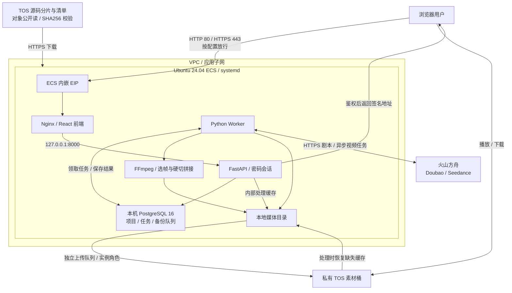

# AI 剧本与视频创作工作室

使用 Terraform 和 `volcengine/volcenginecc` 在火山引擎创建网络、ECS、TOS 和实例角色，自动部署基于 React、FastAPI、Python Worker、PostgreSQL 和 FFmpeg 的单用户、多项目创作工作室。用户可以从故事创意生成剧本和分镜，逐镜头生成视频、配置参考素材，再拼接并下载成片。

## 1. 业务背景

短视频创作需要完成故事构思、分镜设计、画面生成和剪辑，直接使用独立模型接口时，常见问题包括：

- **创作流程分散**：剧本、提示词、视频与成片分别保存，修改后难以追踪对应版本。
- **镜头衔接困难**：人物外貌、服装、位置和动作容易变化，下一镜头可能重复上一镜头的动作。
- **异步任务难管理**：视频生成需要等待云端处理，网络中断、审核失败或下载失败时容易重复提交。
- **素材留存不完整**：只有临时视频地址，没有持久化素材和任务记录，难以继续编辑或复核问题。

本方案将项目设置、结构化分镜、模型任务、参考素材、视频归档和成片导出放在同一个工作室中。用户先审阅分镜，再手动触发生成，并通过上一镜头出点帧辅助保持连续性。

## 2. 方案概述

- **网络与计算**：独立 VPC、一个 `/24` 应用子网、安全组和 Ubuntu 24.04 ECS。ECS 内嵌公网 EIP，Nginx 提供前端与反向代理；Web 和 SSH 来源由参数控制。
- **应用与数据库**：React/TypeScript 前端、FastAPI API 和独立 Python Worker；PostgreSQL 16 在 ECS 本机保存项目、分镜、任务、租约和备份队列。API 与数据库不开放公网端口。
- **模型**：默认使用 Doubao 2.1 生成剧本、Seedance 2.0 生成视频，项目可选择其他已开通模型或推理接入点。模板只配置模型 ID，不创建 Ark Endpoint 或 API Key。
- **交付**：Terraform 将源码和预构建前端编码为 16 KiB 的 TOS 分片，全部上传后发布校验清单；ECS 下载、合并、校验，通过 systemd 安装和启动原生服务。
- **素材与成片**：私有 TOS 保存最终素材，浏览器通过短期签名地址直连播放和下载。ECS 本地目录用于暂存、选帧和拼接，独立上传队列负责转存；处理时可从 TOS 恢复缺失的本地缓存。



创作流程：**创建作品 → 生成剧本 → 编辑并确认分镜 → 逐镜头生成 → 审阅画面与衔接 → 拼接成片 → 预览或下载 MP4**。分镜可以导出为 JSON；项目支持创建、切换、搜索、归档和恢复。

默认模型 ID 为 `doubao-seed-2-1-pro-260628` 和 `doubao-seedance-2-0-260128`，方舟地址为 `https://ark.cn-beijing.volces.com/api/v3`。部署前需要在目标账号确认模型权限与可用性。模型生成和重生成会产生调用费用，保存设置和预览提示词不会调用模型。

## 3. IaC 设计

### 3.1 资源清单

云资源使用 `volcengine/volcenginecc = 0.0.73`；Terraform 版本要求 `>= 1.5.7, < 2.0`。销毁等待使用 `hashicorp/time = 0.14.2` 的 `time_sleep`，不执行本地命令。

| Terraform 资源 | 逻辑名称 | 数量 | 用途 |
| --- | --- | ---: | --- |
| `volcenginecc_vpc_vpc` | `app` | 1 | 独立 VPC |
| `volcenginecc_vpc_subnet` | `app` | 1 | 应用 `/24` 子网 |
| `volcenginecc_vpc_security_group` | `app` | 1 | SSH、HTTP、HTTPS 来源控制 |
| `volcenginecc_ecs_instance` | `app` | 1 | 按量 CPU ECS、系统盘、主网卡、EIP 及角色关联 |
| `volcenginecc_tos_bucket` | `assets` | 1 | 私有媒资桶，默认启用版本控制 |
| `volcenginecc_tos_bucket_cors` | `assets` | 0 或 1 | `cors_allowed_origins` 非空时创建 CORS |
| `volcenginecc_iam_policy` | `assets` | 1 | 限定媒资桶的查询及对象读写删除权限 |
| `volcenginecc_iam_role` | `app` | 1 | 信任 ECS，绑定运行时所需策略 |
| `volcenginecc_iam_policy` | `delivery` | 0 或 1 | 设置 `source_release` 时授权读取指定私有源码包 |
| `volcenginecc_tos_bucket` | `source` | 0 或 1 | 自动交付时创建的独立源码桶 |
| `volcenginecc_tos_object` | `source_parts` | N | 自动交付源码分片，每片最多 16 KiB |
| `volcenginecc_tos_object` | `source` | 0 或 1 | 分片全部完成后发布的校验清单 |
| `time_sleep` | `eni_release_wait` | 1 | ECS 删除后、删除安全组前的销毁阶段等待，不创建云资源 |

当前参数使用自动交付、未配置 CORS；当前源码与前端产物计算得到 N = 14，共 23 个云资源和 1 个等待资源。N 随打包内容变化，以执行计划及 `source_delivery.chunk_count` 为准。EIP、系统盘、主网卡和角色关联为 ECS 内嵌配置，不另计独立资源；PostgreSQL、数据库账号、Web 登录密码和应用服务由 ECS 安装器创建。本工程没有 Data Source 或子模块；镜像、密钥对、云项目和方舟模型权限由部署者提前准备。

交付模式：

| 配置 | 行为 |
| --- | --- |
| `auto_source_upload = true`，`source_release = null` | 默认模式，Terraform 自动上传分片并启动应用 |
| 设置 `source_release` | 使用已有私有 TOS 发布包，优先于自动上传 |
| `auto_source_upload = false`，`source_release = null` | 创建基础设施和主机基础配置，不安装应用源码 |

源码桶和媒资桶的桶 ACL 均为私有；仅自动交付的源码分片和清单为公开读，不能包含凭据或业务素材。`ark_api_key` 必须直接通过 Terraform 敏感参数传入，安装器将其写入 ECS 的 `/opt/ai-animation/secrets/ark_api_key`，权限为 `0600`。Key 会进入 Terraform State、保存的 Plan 和 ECS User Data；`sensitive` 仅隐藏常规界面的显示，不会从这些数据中移除秘密。密码模式的 `ecs_password` 也会进入 State 和 Plan。

### 3.2 工程结构

```text
.
├── backend/
│   ├── app/                     # API、Worker、模型适配、媒体处理与备份
│   └── requirements.txt
├── frontend/
│   ├── src/                     # React/TypeScript 创作界面
│   ├── dist/                    # 构建产物，自动交付前必须存在
│   ├── nginx.conf
│   └── nginx-public.conf
├── scripts/
│   ├── package-release.py       # 构建前端并生成完整交付包
│   ├── ecs-bootstrap.sh         # ECS 安装入口
│   ├── ecs-deploy.py            # 下载、合并和校验源码
│   ├── ecs-native.py            # 数据库与 systemd 服务安装
│   └── ecs-public-web.py        # Nginx 与测试 HTTPS 配置
├── main.tf                      # 网络、ECS、媒资桶与 IAM
├── delivery.tf                  # 源码编码、分片和清单
├── bootstrap.tf                 # 运行配置与 cloud-init
├── variables.tf
├── outputs.tf
├── versions.tf
├── providers.tf                 # Provider 配置
├── terraform.tfvars             # 本地部署参数
├── compose.yaml                 # 可选本地容器运行
├── compose.dev.yaml
├── README.md                    # 英文说明
└── README.zh-CN.md               # 中文说明
```

本发布目录包含预构建的 `frontend/dist/` 和已纳入版本管理的 `terraform.tfvars`；部署前应将环境参数替换为目标账号的配置，修改前端源码后需重新构建。`terraform.tfvars` 不进入自动生成的源码包；State、Plan、`.env`、`secrets/`、`config/runtime.json`、`data/` 和 `work/` 由 Git 忽略，且同样不进入源码包。部署与运维步骤见第 4 节。

所有 Terraform 资源在根模块定义。启动链为 `bootstrap.tf` → `scripts/ecs-bootstrap.sh` → `scripts/ecs-deploy.py` → `scripts/ecs-native.py`；网页前后端源码完整包含在 `frontend/src/` 和 `backend/app/` 中。

### 3.3 核心代码示例

`delivery.tf` 将运行文件集合编码并拆分为小对象，清单引用编码后大小、分片数和校验值。以下为清单资源的关键字段节选：

```hcl
resource "volcenginecc_tos_object" "source" {
  count      = local.auto_delivery ? 1 : 0
  bucket     = volcenginecc_tos_bucket.source[0].name
  key        = "releases/${local.source_payload_sha256}/manifest.json"
  content    = local.source_manifest
  public_acl = "public-read"
  depends_on = [volcenginecc_tos_object.source_parts]
  # 完整配置还包含内容类型、加密、标签和大小前置校验。
}
```

`bootstrap.tf` 将清单位置、清单 SHA256 和源码 SHA256 写入部署配置。ECS 按编号下载分片，校验清单、分片长度、合并内容和解压后源码，通过后才安装应用。编码内容上限 10 MiB，解压后的 JSON 上限 100 MiB；仍兼容旧单对象和私有 `.tar.gz` 交付。

创建依赖为 `安全组 → time_sleep.eni_release_wait → ECS`，销毁顺序反向执行，默认等待 120 秒缓解网卡异步解绑问题。创建阶段不设置等待，销毁阶段不调用 Python 或 Shell 命令；只有等待对象已通过 Apply 写入 State，后续 Destroy 才会执行它。

分片使用 Terraform 默认并发。更换源码交付方式会增删相应的源码桶、对象和读取策略；部署前应检查执行计划。部署和验证步骤见第 4 节。

## 4. 使用说明

本工程支持通过 InfraManager 在云上一键部署或下载模板在本地运行。推荐使用云上部署方式，无需自行准备 Terraform 运行环境，只需在平台填写参数即可完成资源创建和托管。

### 4.1 云上部署

InfraManager 是火山引擎提供的 Terraform 托管工作台，更多产品介绍参见 [InfraManager 产品介绍](https://docs.volcengine.com/docs/infrastructure-management/product-introduction?lang=zh)。

#### 4.1.1 准备权限

资源栈执行身份需要 CloudControl 及 VPC、子网、安全组、ECS、磁盘、网卡、EIP、TOS、IAM Role/Policy 的管理和关联权限，包括向 ECS 传递角色。ECS 运行时使用模板创建的实例角色访问指定桶或对象，部署身份与运行时身份用途不同。

在目标地域准备 Ubuntu 24.04 amd64 镜像、可用 CPU ECS 规格、EIP 和磁盘配额，以及全局唯一的媒资桶名。建议从 4 vCPU / 8 GiB 起步，实际容量取决于并发生成、视频归档和 FFmpeg 负载。

通过 [火山方舟控制台](https://console.volcengine.com/ark) 开通剧本和视频模型，并创建有权调用所选模型的 API Key。Ark Key 与云账号 AK/SK、模型 ID 或 `ep-...` 接入点 ID 不同，部署时必须通过平台敏感参数 `ark_api_key` 提供。密钥文件与状态存储说明见第 3.1 节。

ECS 需要访问 TOS、Ubuntu 软件源、Python 包源和方舟 HTTPS 接口。原生安装统一使用 `https://mirrors.ivolces.com/pypi/simple/`；前端在发布机预构建，ECS 不需要安装 npm 或 Docker。

#### 4.1.2 选择模板

打开 [InfraManager 控制台](https://console.volcengine.com/iac)，进入 **模板管理 > 公开模板**，搜索“AI 剧本与视频创作工作室”。

上述搜索入口适用于模板已公开上架的情况，本文未确认上架状态。搜索不到时，按平台支持的自定义模板导入方式上传完整工程，必须保留根目录 Terraform 文件、`scripts/`、后端源码、Nginx 配置和 `frontend/dist/` 的相对目录结构。仅导入 `.tf` 文件无法完成应用安装。

发布者在安装 Node.js/npm 和 Python 3 的机器上执行：

```bash
npm --prefix frontend ci
python3 scripts/package-release.py --version v2026.11.10-native
```

脚本在本地工程根目录运行，需要 Python 3、Node.js/npm 及包源网络访问；会构建前端，并在 `releases/` 输出 `.tar.gz`、SHA256、元数据和私有发布包参数示例。重复运行相同版本会重新打包，内容变更后应使用新版本和新 SHA256；成功退出码为 `0`，构建或打包异常为非零，脚本未设置总超时，可用 Ctrl+C 停止。它不上传文件或创建云资源，临时产物不再使用后可自行删除。

源码发布包排除本地 `terraform.tfvars`、State、Plan、`.env`、密钥和媒体数据；内部包含供安装器校验的逐文件清单。该包用于 ECS 源码安装，不代替 InfraManager 所需的完整 Terraform 工程。部署参数按第 4.2.1 节单独提供。

#### 4.1.3 创建资源栈

选择模板并点击 **创建资源栈**，根据实际需求填写资源栈信息和模板参数。创建并检查执行计划，确认变更符合预期后，点击 **执行部署**。

参数说明见第 4.2.1 节。必须提供 `zone_id`、`image_id`、`instance_type`、`bucket_name`、`ssh_allowed_cidrs`、`ark_api_key` 和登录模式对应的 ECS 凭据。

默认密钥模式填写已有 `ssh_key_pair_name`，并显式将 `ecs_password` 设为 `null`；密码模式将密钥对名称留空，通过敏感参数提供真实 `ecs_password`，替换公开示例默认值。配置 `web_allowed_cidrs` 后才开放公网 80/443；空集合保留 SSH 隧道访问。

检查计划中的分片数量、桶名、来源 CIDR、角色权限以及删除或替换动作，再执行部署。Terraform/资源栈成功表示资源创建完成，应用的下载和安装可能仍在进行。

#### 4.1.4 部署验证

在资源栈详情页查看部署状态为“成功”，再查看模板输出：

| 输出 | 用途 |
| --- | --- |
| `infrastructure` | VPC、子网、安全组、ECS 标识、子网 CIDR 和公网 IP |
| `asset_storage` | 私有媒资桶、内外网 Endpoint、ECS 角色 TRN |
| `runtime_config` | 不含密钥的模型、存储、角色和 Worker 配置 |
| `application_access` | 公网 URL、SSH 隧道、配置和证书路径、状态与日志命令 |
| `source_delivery` | 交付模式、桶、对象键、源码 SHA256、公开清单地址及分片数 |

输出不返回登录密码或 API Key，但包含资源地址和运行配置。默认自动交付的数量为 N + 9 个云资源和 1 个等待资源；在资源页签核对资源类型和状态，数量说明见第 4.2.3 节。Web 来源为空时公网 URL 为 `null`。

从 `infrastructure.instance_id` 定位 ECS，在 ECS 控制台终端或 SSH 会话中执行：

```bash
sudo cloud-init status
sudo cat /opt/ai-animation/deployment-status.json
sudo systemctl is-active ai-animation-api.service ai-animation-worker.service nginx.service
curl --fail --silent --show-error --max-time 15 http://127.0.0.1:8080/api/health
```

应用就绪后，部署状态的 `phase` 为 `ready`，三个常驻服务为 `active`，健康接口返回 `{"status":"ok"}`。Key 缺失或格式非法时安装会在 `configuring_secret` 阶段失败；Key 文件非空仍不等于模型权限已通过真实调用验证。

安装异常时查看状态与日志：

```bash
sudo systemctl status ai-animation.service ai-animation-api.service ai-animation-worker.service nginx.service --no-pager
sudo journalctl -u ai-animation.service -u ai-animation-api.service -u ai-animation-worker.service -n 100 --no-pager
```

更新 Ark Key 时应更新平台敏感参数并查看 Terraform Plan。修改 ECS User Data 不会让已有实例自动重跑 cloud-init；若实例未替换，需要通过受控运维流程更新 `/opt/ai-animation/secrets/ark_api_key` 并重启 API 和 Worker 服务。不要把密钥写进命令参数或日志。

在受控终端读取工作室登录密码：

```bash
sudo cat /opt/ai-animation/secrets/owner_password
```

打开 `application_access.public_http_url` 或 `public_https_url`，用该密码登录。Web 密码与 ECS 登录凭据不同。HTTPS 默认使用一年有效期的自签名测试证书；可信域名访问需替换 `/etc/nginx/ssl/ai-animation/tls.crt` 和 `tls.key`，再检查并重载 Nginx。

未开放公网 Web 时，按 `application_access.ssh_tunnel_command` 建立隧道，再打开 `http://127.0.0.1:8080`。该本地端口被其他应用占用时，可改用其他本地转发端口。

业务验收：

1. 创建测试作品，配置创意、两名角色、时长、画幅和模型，生成并审阅结构化剧本。
2. 生成第一镜头，确认视频可播放；在下一镜头的“参考素材”中提取前镜头出点帧并预览，保存后手动生成。
3. 检查人物、服装、动作和声音衔接；全部镜头就绪后拼接，在“我的成片”中播放并下载 MP4。
4. 查看任务记录中的状态、方舟 Task ID 和失败诊断；确认视频和参考帧显示“已备份到云端”。
5. 上传完成后，在浏览器开发者工具的网络面板确认预览和下载直接请求 TOS 签名地址；链接到期后重新打开预览，应能取得新地址。上传失败时点击“重试上传”，确认沿用原素材和方舟 Task ID。
6. 按需重启 ECS，服务恢复后确认项目、任务和 TOS 素材仍可访问。此项检查持久化与服务自启动；数据库备份仍需单独准备。模型审核拒绝应按实际错误处理，不能以接口受理代替视频成功。

验证作品不再需要时可归档；归档保留素材，不释放存储。整体数据清理见第 4.2.5 节。

### 4.2 本地部署

您也可以下载本工程模板在本地运行，需要按照下述步骤操作。

以下 Terraform 命令在 macOS、Linux 或 WSL 的本项目根目录执行，用于部署云端资源；ECS 状态检查和密钥配置仍在 ECS 终端执行。

#### 4.2.1 环境准备

**基础环境**：

准备 Terraform `>= 1.5.7, < 2.0`，以及可访问火山引擎 API 的网络环境。本发布目录已包含 `frontend/dist/`，部署前无需重新构建；发布打包需要 Python 3、Node.js/npm。Provider 版本由 `versions.tf` 固定，配置位于 `providers.tf`，当前未包含依赖锁文件，`terraform init` 会生成 `.terraform.lock.hcl`。

**服务与配额**：

按第 4.1.1 节在控制台准备部署权限、镜像、密钥对、ECS/EIP/磁盘配额，以及已开通模型的方舟 Key。两种部署入口使用相同的云资源权限。

**凭证注入**（推荐环境变量，不要写入代码或 `tfvars`）：

```bash
export VOLCENGINE_ACCESS_KEY="your_access_key"
export VOLCENGINE_SECRET_KEY="your_secret_key"
export VOLCENGINE_REGION="cn-beijing"
```

临时凭据还需设置 `VOLCENGINE_SESSION_TOKEN`。本工程 Provider 显式使用 `region` 参数，环境变量不会覆盖它；两者应保持一致。

**敏感业务变量**：`ark_api_key` 为必填敏感字段，用于调用方舟模型；`ecs_password` 为密码登录模式下的敏感字段。建议通过环境变量注入，不要写入 `terraform.tfvars`：

```bash
export TF_VAR_ark_api_key="<your_ark_api_key>"
# 仅在 ECS 密码登录模式下注入。
export TF_VAR_ecs_password="<strong-password>"
```

将占位内容替换为真实值，并保护终端历史。`terraform.tfvars` 中的同名赋值优先于 `TF_VAR_*`：环境变量注入前应移除 `ark_api_key` 的文件赋值；密码模式还应移除 `ecs_password` 的文件赋值，包括 `null`。密钥模式则在文件中保留 `ecs_password = null`，不使用密码环境变量。

**重点参数**：

核对本地 `terraform.tfvars`，按目标账号调整；使用未包含此文件的完整工程包时，可按下表新建参数文件。默认值来自 `variables.tf`，可能与本地环境的实际配置不同：

| 参数 | 默认值 / 入口 | 说明 |
| --- | --- | --- |
| `region` / `zone_id` | `cn-beijing` / 必填 | 地域及有库存的可用区 |
| `project_name` / `name_prefix` | `default` / `ai-animation` | 云项目及资源名前缀 |
| `tags` | `{}` | 附加标签 |
| `vpc_cidr` | `10.42.0.0/16` | 自动派生首个非零 `/24` 子网，默认 `10.42.1.0/24` |
| `image_id` | 必填 | Ubuntu 24.04 amd64、启用 cloud-init 的镜像 |
| `instance_type` | 必填 | 可用 CPU ECS 规格，建议 4 vCPU / 8 GiB 起 |
| `ecs_login_mode` | `key_pair` | `key_pair` 或 `password` |
| `ssh_key_pair_name` | `null` | 密钥模式必填已有密钥对名称 |
| `ecs_password` | `ReplaceWithStrongPassword123`，敏感 | 公开示例默认密码；实际密码登录应替换，密钥登录须显式设为 `null` |
| `ssh_allowed_cidrs` | 必填 | 非空管理员 IPv4 CIDR 集合 |
| `web_allowed_cidrs` | `[]` | 80/443 来源集合，空值关闭公网 Web 入站 |
| `system_disk_size_gib` / `system_disk_type` | `100` / `ESSD_FlexPL` | 系统盘大小与类型，大小至少 40 GiB |
| `delete_system_disk_with_instance` | `true` | 默认随 ECS 删除系统盘；设为 `false` 则保留并继续计费 |
| `deletion_protection` | `false` | ECS 云端删除保护 |
| `eni_release_wait_seconds` | `120` | ECS 删除后等待网卡释放，范围 0–900 秒 |
| `public_bandwidth_mbps` | `10` | 按流量计费 EIP 的带宽上限 |
| `bucket_name` | 必填 | 全局唯一的私有媒资桶名 |
| `bucket_versioning` | `Enabled` | 媒资桶版本控制，可设为 `Suspended` |
| `cors_allowed_origins` | `[]` | 精确浏览器 Origin；空值不创建 CORS |
| `auto_source_upload` | `true` | Terraform 自动上传源码分片和清单 |
| `source_release` | `null` | 已有私有源码包引用，覆盖自动上传 |
| `ark_api_key` | 必填，敏感 | 方舟 API Key；直接传入后端密钥文件，并进入 Terraform State |
| `ark_base_url` | `https://ark.cn-beijing.volces.com/api/v3` | 方舟 API 地址 |
| `script_model_id` | `doubao-seed-2-1-pro-260628` | 默认剧本模型，可在项目内覆盖 |
| `video_model_id` | `doubao-seedance-2-0-260128` | 默认视频模型，可在项目内覆盖 |
| `media_url_ttl_seconds` | `900` | 素材签名地址有效期，整数 60–3600 秒；实例角色凭据剩余有效期不足时自动缩短 |
| `application_compose_path` | `null` | 云端 Compose 模式已停用，保持空值 |

两种登录凭据互斥：密钥模式只填写密钥对名称，密码模式只填写密码。`ark_api_key` 必须通过平台敏感参数或 `TF_VAR_ark_api_key` 提供。自动加载的 `terraform.tfvars` 优先于 `TF_VAR_*`；通过环境变量注入参数时，不要在参数文件中为同名变量赋值。

#### 4.2.2 场景化部署示例

修改过前端源码时先重新构建；直接使用未修改的预构建发布版本时可跳过：

```bash
npm --prefix frontend ci
npm --prefix frontend run build
```

初始化与校验：

```bash
terraform init
terraform fmt -check -recursive
terraform validate
```

以下场景用于独立新环境。先按目标账号填写基础参数，示例资源标识均为占位内容：

```hcl
region            = "cn-beijing"
zone_id           = "cn-beijing-a"
image_id          = "image-REPLACE"
instance_type     = "ecs.g3i.xlarge"
bucket_name       = "your-unique-media-bucket"
ssh_allowed_cidrs = ["203.0.113.10/32"]
web_allowed_cidrs = ["203.0.113.10/32"]
```

替换镜像、规格、桶名和来源地址，确认可用区库存；方舟 Key 按第 4.2.1 节注入。

**场景一：自动上传源码，密钥登录 ECS。** 在已补齐必填参数的 `terraform.tfvars` 中设置：

```hcl
auto_source_upload = true
source_release     = null
ecs_login_mode     = "key_pair"
ssh_key_pair_name  = "your-existing-key-pair"
ecs_password       = null
```

```bash
terraform plan -out=自动交付.tfplan
terraform show 自动交付.tfplan
terraform apply 自动交付.tfplan
```

一次 Apply 会创建基础设施、上传当前源码分片并触发 ECS 安装。使用 Terraform 默认并发；不要复用修改模板前生成的旧 Plan。

**场景二：使用已有私有发布包，密码登录 ECS。** 用发布脚本产生源码包并上传到已有私有交付桶，按输出的完整 SHA256 填写：

```hcl
ecs_login_mode    = "password"
ssh_key_pair_name = null
# ecs_password 通过 TF_VAR_ecs_password 或平台敏感参数提供。

source_release = {
  bucket     = "your-existing-delivery-bucket"
  region     = "cn-beijing"
  endpoint   = "https://tos-cn-beijing.volces.com"
  object_key = "releases/<version>/<sha256>/<archive>.tar.gz"
  sha256     = "<64-lowercase-hex-sha256>"
}
```

```bash
terraform plan -out=私有交付.tfplan
terraform show 私有交付.tfplan
terraform apply 私有交付.tfplan
```

此模式不创建自动源码桶及分片，增加私有发布包读取策略，使用实例角色读取指定对象。`source_release.version_id` 可固定对象版本；不填写时应使用不可变对象键。密码必须通过环境变量或平台参数替换示例默认值。

**场景三：仅创建基础设施。** 设置 `auto_source_upload = false`、`source_release = null`，保留必填方舟 Key 和有效 ECS 登录配置：

```bash
terraform plan -out=基础设施.tfplan
terraform show 基础设施.tfplan
terraform apply 基础设施.tfplan
```

该模式创建网络、ECS、媒资桶和角色，写入主机基础配置，但不安装工作室；没有网页健康检查或模型业务能力。后续启用源码交付时仍需检查 ECS 安装是否实际触发。

所有模式都要求直接提供 `ark_api_key`。已有环境切换交付、登录或启动配置时，应检查删除及替换动作。修改 ECS User Data 不会在已有主机自动重跑 cloud-init。

#### 4.2.3 部署预期结果

基础资源为 7 个云资源；`time_sleep` 另计 1 个：

| 场景 | 云资源数 | Terraform 管理对象总数 |
| --- | ---: | ---: |
| 自动交付，未配置 CORS | N + 9，当前 N = 14 时为 23 | N + 10，当前为 24 |
| 已有私有发布包，未配置 CORS | 8 | 9 |
| 仅基础设施，未配置 CORS | 7 | 8 |

`cors_allowed_origins` 非空时各增加 1 个 CORS 资源。自动交付的 N 随源码与前端产物变化。ECS、EIP 和磁盘产生计算与网络费用；TOS 产生存储、请求及流量费用；方舟生成和重生成按模型使用量计费。

通过以下命令查看输出：

```bash
terraform output
terraform output -json infrastructure
terraform output -json application_access
terraform output -json source_delivery
```

输出完整说明见第 4.1.4 节。基础设施模式下 `application_access.source_deploy_enabled` 为 `false`，`source_delivery.mode` 为 `infrastructure_only`；输出中的访问地址不代表工作室已安装。

#### 4.2.4 部署后验证

从第 4.2.3 节的 `infrastructure.instance_id` 和 `application_access` 定位 ECS 与访问入口。自动交付和私有发布包模式按第 4.1.4 节检查安装状态、Web 登录、剧本、视频、首帧衔接、成片下载、签名地址和上传重试；私有模式还需确认 `source_delivery` 的桶、对象键及 SHA256 与发布包一致。

仅基础设施模式在 ECS 控制台确认实例运行、所属 VPC/子网、安全组和角色正确，通过 SSH 确认 `cloud-init status` 完成及 `/opt/ai-animation/config/runtime.json` 存在；不要求应用服务为 `active`。所有模式都应确认安全组只允许指定来源访问 22/80/443，数据库与 API 端口未公开。

配置未改变时检查计划：

```bash
terraform plan -detailed-exitcode
```

退出码 `0` 表示无变更，`2` 表示存在变更，`1` 表示错误。出现差异时先核对实际云资源与参数；创建结果不确定或对象已存在时，先查询资源，避免重复创建。出现 `Resource Not Found` 时先核对资源栈、控制台与 State 的对应关系。

运行失败优先查看 `deployment-status.json` 和第 4.1.4 节的服务日志：下载失败检查源码交付，模型失败检查 Key、模型权限与任务记录，媒体不可播放检查上传状态和签名地址。业务任务结果不确定时先查询已有方舟 Task ID，避免重复计费。

#### 4.2.5 销毁资源

本工程支持 Terraform 销毁托管资源；非空 TOS 桶需要先人工清理。销毁前备份 PostgreSQL、媒体、密钥和运行时配置，确认目录、Workspace、参数与凭据属于目标环境。

若启用 ECS 删除保护，应先解除并应用；若要保留系统盘，应先将 `delete_system_disk_with_instance` 设为 `false`，审查并应用变更，确认没有替换实例。直接 Destroy 不会先应用待生效的磁盘策略。

确认数据已备份到不会随本栈删除的位置后，在 TOS 控制台清理媒资桶全部对象、历史版本和删除标记；自动交付的源码桶也应检查残留对象。仅删除当前版本不能清空版本化桶。再查看删除计划并执行：

```bash
terraform plan -destroy
terraform destroy
terraform state list
```

当前 `main.tf` 的媒资桶设置为 `prevent_destroy = false`，源码桶也未开启该保护，不能依赖 Terraform 阻止桶删除。运行时上传的媒体不是独立 Terraform 资源；非空桶、历史版本或删除标记可能阻止删除，需要按已确认的数据保留方案单独处理，不要将“创建了备份”等同于“可以删除备份桶”。

- 系统盘默认 `delete_system_disk_with_instance = true`，随 ECS 删除，其中的 PostgreSQL 数据、本地媒体、密钥和运行配置也会删除，销毁前应备份需要保留的数据。设为 `false` 则保留系统盘并继续计费。
- 对已有 ECS，仅修改 `terraform.tfvars` 不会更新云端磁盘策略。销毁前应先检查 `terraform plan` 并应用变更，确认 ECS 为原地更新、没有替换；直接 Destroy 不会先应用待生效的磁盘策略。若 ECS 已删除，应单独处理保留盘，不要执行会重建实例的 Apply。
- 自动交付的源码桶和对象在管理范围内；已有私有发布包、已有 ECS 密钥对及手工创建的 Ark Key 不随栈自动删除。
- 网卡释放等待默认 120 秒，不保证云端一定已完成解绑。若 ECS 已删除、销毁仍失败，核对网卡和安全组关系后继续 Destroy，不要为了补等待对象执行会重建 ECS 的完整 Apply。
- 等待秒数使用 State 中已应用的值；修改后需先审查并 Apply 才对后续销毁生效。若启用 ECS 删除保护，先按计划解除保护。
- 完成后核对 State、控制台残留资源和费用；State 为空不表示保留盘或外部资源已经清理。

### 4.3 创作、参考素材与任务恢复

- **项目与模型**：项目可搜索、归档和恢复，归档保留素材但不能继续编辑或生成。项目设置支持模型目录或自定义 Model ID/Endpoint；管理员可在运行配置的 `model_catalog` 中维护选项，目录不代表账号已开通权限。
- **生成规格**：支持 16:9、9:16、1:1、4:3、3:4、21:9，480p/720p/1080p、声音、水印和 1–72 小时云端超时，默认 48 小时。fast/mini 不支持 1080p，1.0 pro 须关闭声音；未知接入点需补充能力映射。
- **修改与快照**：保存设置不自动生成。修改视频模型、画幅等规格会保留旧素材并标记需重生成；只修改剧本模型或超时不作废已有视频。任务冻结提交配置，恢复使用原快照。
- **当前编辑限制**：项目中任一任务排队或执行时，页面会禁用整个项目的分镜编辑与生成操作。保存分镜会重置其视频关联和成片关联，即使内容未修改也会发生；TOS 文件仍保留，但页面没有历史视频恢复入口。保存已有视频的分镜前应先下载需要保留的作品。
- **首帧衔接**：在后镜头的“参考素材”中选择首帧模式，按统一 24 fps 提取上一镜头出点帧，审阅后确认配置。确认同时保存上一镜头硬切出点，再手动生成后镜头；上游视频或出点变化后需重新确认引用。
- **首尾帧与多模态**：文字、首帧、首尾帧、多模态参考为互斥模式。首尾帧需分别提供尺寸相同的起始与目标结束图片，即使是最后一个镜头也需要尾帧。图片接受 PNG/JPEG，单张不超过 29 MB，边长 300–6000，宽高比 0.4–2.5；首帧须匹配项目画幅，使用 `ratio=adaptive`。
- **参考音视频**：多模态最多 9 张图片、3 份视频、3 份音频，总数不超过 12。每份音视频 2–15 秒，同类合计不超过 15 秒；音频须搭配视觉参考并启用声音。按类别顺序用“图片1”“视频1”“音频1”引用素材。
- **地址与完整性**：图片由后端保存、绑定 SHA256 并以 Base64 提交，组合请求体受 64 MB 限制。输入音视频目前只接收受信域名的长期公网 HTTPS 地址，不接受临时签名查询参数或 `asset://`；实际格式、时长与可达性由方舟进一步校验。
- **失败诊断**：“任务记录”提供中文解释、云端错误码、原因和 Request ID，可展开并复制，剪贴板不可用时支持手动复制。不保存完整响应体或密钥；历史未保存的错误详情无法重建。
- **恢复规则**：已有方舟 Task ID 时继续查询和归档，不重复提交；明确终止后重提需确认计费。提交中断且没有记录 ID 时先在方舟核对并补充 ID，不要直接创建重复任务。剧本请求失败最多自动重试 2 次，总时限 10 分钟，支持取消。
- **恢复与剧本互斥**：剧本或拼接任务活跃时不能恢复旧镜头视频，不同镜头的视频仍可排队。恢复接口加锁后重新核对最新任务状态，已恢复的任务返回 409；剧本替换前再次检查活跃旧镜头任务，保留其分镜关联并提示先处理任务。
- **成片导出**：FFmpeg 统一画幅、24 fps、H.264/AAC 和 48 kHz 音频，按确认出点硬切；启用声音时为静音片段补音轨。模型实际时长和语音可能偏离剧本，需人工检查最终效果。

### 4.4 素材备份与运行检查

云端默认启用 `storage.auto_upload=true`，目标来自 `bucket_name`，不是写死的桶名。备份覆盖已归档的新旧分镜视频、成片、模型结束帧、抽取参考帧、上传图片和选帧预览视频。

对象位于 `media/<project_id>/<asset_id>/`，使用私有 ACL、AES256 和 SDK CRC 校验；上传后 HEAD 校验大小及 SHA256 元数据。备份队列独立于模型任务，失败不会重生成视频，重试间隔从 30 秒增长至最多 30 分钟；Worker 中断后可在租约到期后恢复。界面显示备份状态并提供“重试上传”。

ECS 使用实例角色获取临时凭据，优先访问 TOS 内网 HTTPS Endpoint。开发机需要真实上传时再配置桶、地域、Endpoint 及后端密钥文件 `TOS_ACCESS_KEY_FILE`、`TOS_SECRET_KEY_FILE`；临时凭据另配 `TOS_SESSION_TOKEN_FILE`。

媒体转存成功后才作为可用素材提供预览或拼接。后端鉴权后签发短期 TOS 地址，浏览器直连播放和下载；默认有效期为 900 秒，可通过 `media_url_ttl_seconds` 调整，前端会刷新过期地址。签名地址在有效期内可访问，应按临时访问凭据对待。

选帧或拼接需要本地文件时，后端可从 TOS 下载缺失缓存；这依赖数据库中仍保留的素材记录和有效 TOS 对象。TOS 只持久化媒体，不备份项目数据库、密钥或运行配置。ECS 数据位置：

| 数据 | 路径 |
| --- | --- |
| PostgreSQL | `/var/lib/postgresql/16/main` |
| 媒体 | `/opt/ai-animation/work/media` |
| 运行配置 | `/opt/ai-animation/config/runtime.json` |
| 密钥 | `/opt/ai-animation/secrets/` |
| 工作室登录密码 | `/opt/ai-animation/secrets/owner_password` |
| 安装状态 | `/opt/ai-animation/deployment-status.json` |

在 ECS 上检查运行状态：

```bash
sudo systemctl is-active ai-animation-api.service ai-animation-worker.service nginx.service
curl --fail --silent --show-error --max-time 15 http://127.0.0.1:8080/api/health
sudo journalctl -u ai-animation-worker.service -n 100 --no-pager
```

确认服务为 `active`、健康接口返回 `{"status":"ok"}`，再核对界面中的备份状态和 Worker 日志。数据库迁移通过 PostgreSQL advisory lock 串行执行，当前 schema 为 `6`，包含任务错误详情和独立媒体备份队列。

工作室登录密码由安装器随机生成，保存在 ECS 的 `owner_password` 文件中，不进入数据库；“本机”指 ECS 服务端。API 通过 systemd 凭据加载密码，正常重启不会重新生成。修改密码时在 ECS 执行：

```bash
sudoedit /opt/ai-animation/secrets/owner_password
sudo systemctl restart ai-animation-api.service
```

将文件内容替换为新密码后保存，保持原有受限权限。修改密码不会主动注销所有已存在的会话；需要同时使旧会话失效时还应轮换会话密钥。方舟 Key 同样仅由服务端使用，网页不保存或回显它。

需要暂停业务处理时，在 ECS 执行 `sudo systemctl stop ai-animation-api.service ai-animation-worker.service`；恢复使用相应的 `start` 命令。暂停不会删除任务或媒体，已提交的方舟任务仍可能继续运行和计费。

目标环境的模型权限、应用健康、镜头连续性及数据恢复按第 4.1.4 节验收。自动化测试套件保留在开发仓库，不随本发布版本交付。

## 5. 总结

本模板将剧本、分镜、视频生成和成片导出放在同一工作室中，以 Terraform 托管云资源、systemd 运行应用、私有 TOS 持久化媒体，适用于演示、功能验证及小规模个人创作。应用与数据库位于单台 ECS，尚不提供多副本、高可用、多人授权、公开分享、监控告警或跨地域灾备。

- 参考帧和连续性提示词只能辅助衔接，不保证人物、动作或声音完全一致；AI 生成人物也可能触发云端真人隐私或版权审核，修改文字不能保证通过。
- 已选择的参考模式不会因审核失败自动退回纯文字生成；需要用户审阅错误并决定后续操作。
- 尚不支持自动连续生成、叠化、音频交叉淡化、ASR/TTS 精确字幕、本地音视频上传后作为方舟参考，以及公开回调入口。
- 网页使用工作室密码登录，公网部署需配置合适的访问来源和可信 HTTPS；自签名证书用于测试。模型 Key 必须直接通过 Terraform 参数提供并保存在后端密钥文件中，不在网页配置或回显。
- 自动交付会公开运行源码；State、Plan、源码交付桶、媒资桶和保留磁盘应分别管理。媒体自动备份不等于完整应用备份，也不替代恢复演练。
