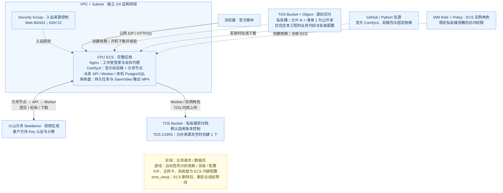

# 自部署 ComfyUI 火山方舟视频生成

在平台填写客户自己的方舟 Key，部署后登录公网 ComfyUI。在官方画布加入「火山方舟视频生成」节点，填写提示词、选择模型和视频参数，点击官方「运行」。节点返回标准 `VIDEO`，画布可以预览视频，连接官方 `SaveVideo` 节点保存 MP4。

## 1. 业务背景

模板面向通过客户火山账号使用 Seedance 文生视频的场景，提供可自部署的 ComfyUI 画布和方舟视频节点。

- **接入步骤分散**：官方画布、自定义节点、业务后端和存储需要配套配置，手工安装容易遗漏组件。
- **凭据与计费归属不清**：客户需要使用自己的方舟 Key，在自己的火山账号下管理模型权限、用量和费用。
- **长任务恢复困难**：视频生成、轮询、下载和归档跨越多个阶段，中断后需要沿用已有任务，避免重复提交。

本方案通过 Terraform 交付基础设施与业务源码，由 ECS 开机自动安装服务。方舟 Key 通过服务端凭据机制加载；官方 Partner Nodes 禁用，流程无需 Comfy 账号或积分。

## 2. 方案概述

Terraform 创建网络、ECS、TOS 和实例角色。ECS 首次开机下载并校验固定版本的官方 ComfyUI，安装前端与 CPU 运行依赖，通过 systemd 启动 ComfyUI、业务后端、Worker 和 PostgreSQL。自定义节点经本机 HTTP 调用业务后端，沿用提交、轮询、下载、错误处理和 TOS 上传队列。



当前节点支持 Seedance 2.0、2.0 fast 和 2.0 mini 的文生视频，时长 4–15 秒，画幅为 16:9、9:16、1:1、4:3、3:4、21:9。分辨率提供 480p、720p、1080p，fast 和 mini 只允许 480p、720p。节点按所选模型校验参数；实际模型可用性和权限以客户方舟账号为准。[方舟参数说明](https://docs.volcengine.com/docs/ark/create-video-generation-task-api?lang=zh)

同一「生成批次」和相同参数复用原业务任务与方舟 Task ID。需要新视频时更换生成批次。画布中断只结束节点等待，已提交的任务继续保留。工作流 JSON、节点输入和浏览器响应均不包含方舟 Key。

## 3. IaC 设计

### 3.1 资源清单

云资源使用 `volcengine/volcenginecc = 0.0.73`；Terraform 版本要求 `>= 1.5.7, < 2.0`。销毁等待使用 `hashicorp/time = 0.14.2` 的 `time_sleep`，不执行本地命令。

| Terraform 资源 | 逻辑名称 | 数量 | 用途 |
| --- | --- | ---: | --- |
| `volcenginecc_vpc_vpc` | `app` | 1 | 独立 VPC |
| `volcenginecc_vpc_subnet` | `app` | 1 | 应用 `/24` 子网 |
| `volcenginecc_vpc_security_group` | `app` | 1 | SSH、HTTP、HTTPS 来源控制 |
| `volcenginecc_ecs_instance` | `app` | 1 | 按量 CPU ECS、系统盘、主网卡、EIP 及角色关联 |
| `volcenginecc_tos_bucket` | `assets` | 1 | 私有媒资桶，默认启用版本控制 |
| `volcenginecc_tos_bucket_cors` | `assets` | 0 或 1 | `cors_allowed_origins` 非空时创建 CORS |
| `volcenginecc_iam_policy` | `assets` | 1 | 限定媒资桶的查询及对象读写删除权限 |
| `volcenginecc_iam_role` | `app` | 1 | 信任 ECS，绑定运行时所需策略 |
| `volcenginecc_tos_bucket` | `source` | 1 | 自动交付当前业务源码的独立源码桶 |
| `volcenginecc_tos_object` | `source_parts` | N | 自动交付源码分片，每片最多 16 KiB |
| `volcenginecc_tos_object` | `source` | 1 | 分片全部完成后发布的校验清单 |
| `time_sleep` | `eni_release_wait` | 1 | ECS 删除后、删除安全组前的销毁阶段等待，不创建云资源 |

自动交付且未配置 CORS 时，共 N + 9 个云资源和 1 个等待对象。当前源码对应 N = 7；当前 `terraform.tfvars` 示例的 `cors_allowed_origins = []`，因此共 16 个云资源、17 个 Terraform 管理对象。源码变化后，N 以执行计划及 `source_delivery.chunk_count` 为准。EIP、系统盘、主网卡和角色关联为 ECS 内嵌配置，不另计独立资源；PostgreSQL、数据库账号、Web 登录密码和应用服务由 ECS 安装器创建。本工程没有 Data Source 或子模块；镜像、密钥模式所需的密钥对、云项目和方舟模型权限由部署者提前准备。

源码交付固定自动执行，无需用户填写交付开关或源码下载地址：

1. 平台执行 Terraform，将当前模板中的自定义节点、认证扩展、业务后端、示例工作流和安装配置编码上传至 TOS。
2. ECS 首次开机自动下载并校验这些业务文件，然后安装、启动完整服务。

官方 ComfyUI 源码、官方前端包、PyTorch 和其他运行依赖不包含在本工程中。官方版本、下载地址和校验值固定在 `scripts/comfyui-release.json`，Python 依赖版本固定在 `scripts/comfyui-requirements.txt` 和 `backend/requirements.txt`；ECS 按这些配置在线下载安装。无需提前下载、打包或上传依赖。

源码桶和媒资桶的桶 ACL 均为私有；仅自动交付的源码分片和清单为公开读，不能包含凭据或业务素材。`ark_api_key` 必须直接通过 Terraform 敏感参数传入，安装器将其写入 ECS 的 `/opt/ai-animation/secrets/ark_api_key`，权限为 `0600`。Key 会进入 Terraform State、保存的 Plan 和 ECS User Data；`sensitive` 仅隐藏常规界面的显示，不会从这些数据中移除秘密。密码模式的 `ecs_password` 也会进入 State 和 Plan。

### 3.2 工程结构

```text
.
├── backend/
│   ├── app/                     # API、Worker、模型适配、媒体处理与备份
│   ├── comfyui_extension.py      # 官方自定义节点与登录保护
│   └── requirements.txt
├── frontend/
│   ├── comfyui-extension/      # 独立登录与 CSRF 扩展
│   │   └── auth.js
│   ├── login/
│   │   ├── index.html
│   │   └── login.js
│   └── nginx/
│       ├── studio.conf
│       └── public.conf
├── scripts/
│   ├── deploy-local.py          # 凭据文件注入与完整 Terraform apply
│   ├── install-comfyui.py       # 官方源码校验、CPU 依赖与扩展安装
│   ├── comfyui-release.json
│   ├── comfyui-requirements.txt # 工作室的固定 Python 依赖
│   ├── ecs-bootstrap.sh         # ECS 安装入口
│   ├── ecs-deploy.py            # 下载、合并和校验源码
│   ├── ecs-native.py            # 数据库与 systemd 服务安装
│   └── ecs-public-web.py        # Nginx 与测试 HTTPS 配置
├── main.tf                      # 网络、ECS、媒资桶与 IAM
├── delivery.tf                  # 源码编码、分片和清单
├── bootstrap.tf                 # 运行配置与 cloud-init
├── variables.tf
├── outputs.tf
├── versions.tf
├── providers.tf                 # Provider 配置
├── terraform.tfvars             # 本地部署参数
├── compose.yaml                 # 可选本地容器运行
├── compose.dev.yaml
├── workflows/                   # 方舟文生视频示例工作流
│   └── ark-text-to-video.json
├── tests/                       # 本地回归测试与假服务数据
├── README.md                    # 英文说明
└── README.zh-CN.md               # 中文说明
```

本工程包含业务扩展、登录入口、固定开源组件清单和 `terraform.tfvars`；部署前将环境参数替换为目标账号的配置。官方前端由 ComfyUI 安装依赖提供，无需 npm 构建。`terraform.tfvars` 不进入自动交付的源码文件集合；State、Plan、`.env`、`secrets/`、`config/runtime.json`、`data/` 和 `work/` 同样不进入源码交付集合。部署与运维步骤见第 4 节。

`compose.yaml`、`compose.dev.yaml` 和各目录中的 Dockerfile 用于本地容器开发，不参与 ECS 原生安装；第 4.2 节的“本地部署”指在本机执行 Terraform 创建云端环境。

所有 Terraform 资源在根模块定义。启动链为 `bootstrap.tf` → `scripts/ecs-bootstrap.sh` → `scripts/ecs-deploy.py` → `scripts/ecs-native.py`。官方 ComfyUI 单独下载并安装；本工程维护 `frontend/comfyui-extension/`、`backend/comfyui_extension.py` 和 `backend/app/` 中的业务适配代码。

### 3.3 核心代码示例

`delivery.tf` 将运行文件集合编码并拆分为小对象，清单引用编码后大小、分片数和校验值。以下为清单资源的关键字段节选：

```hcl
resource "volcenginecc_tos_object" "source" {
  count      = 1
  bucket     = volcenginecc_tos_bucket.source[0].name
  key        = "releases/${local.source_payload_sha256}/manifest.json"
  content    = local.source_manifest
  public_acl = "public-read"
  depends_on = [volcenginecc_tos_object.source_parts]
  # 完整配置还包含内容类型、加密、标签和大小前置校验。
}
```

`bootstrap.tf` 将清单位置、清单 SHA256 和源码 SHA256 写入部署配置。ECS 按编号下载分片，校验清单、分片长度、合并内容和解压后源码，通过后才安装应用。编码内容上限 10 MiB，解压后的 JSON 上限 100 MiB。

创建依赖为 `安全组 → time_sleep.eni_release_wait → ECS`，销毁顺序反向执行，默认等待 120 秒缓解网卡异步解绑问题。创建阶段不设置等待，销毁阶段不调用 Python 或 Shell 命令；只有等待对象已通过 Apply 写入 State，后续 Destroy 才会执行它。

分片使用 Terraform 默认并发；部署前应检查执行计划。部署和验证步骤见第 4 节。

## 4. 使用说明

本工程支持通过 InfraManager 在云上一键部署或下载模板在本地运行。推荐使用云上部署方式，无需自行准备 Terraform 运行环境，只需在平台填写参数即可完成资源创建和托管。

### 4.1 云上部署

InfraManager 是火山引擎提供的 Terraform 托管工作台，更多产品介绍参见 [InfraManager 产品介绍](https://docs.volcengine.com/docs/infrastructure-management/product-introduction?lang=zh)。

#### 4.1.1 准备权限

模板使用平台现有部署身份创建资源并自动交付源码，不在平台执行本地安装或验收脚本，无需为本模板额外配置 Python、AK/SK 或云助手。安装脚本及依赖均在 ECS 内运行。

资源栈执行身份需要 CloudControl 及 VPC、子网、安全组、ECS、磁盘、网卡、EIP、TOS、IAM Role/Policy 的管理和关联权限，包括向 ECS 传递角色。ECS 运行时使用模板创建的实例角色访问指定桶或对象，部署身份与运行时身份用途不同。

在目标地域准备 Ubuntu 24.04 amd64 镜像、可用 CPU ECS 规格、EIP 和磁盘配额，以及全局唯一的媒资桶名。建议从 4 vCPU / 8 GiB 起步，实际容量取决于并发生成、视频归档和 FFmpeg 负载。

通过 [火山方舟控制台](https://console.volcengine.com/ark) 开通所选 Seedance 视频模型，并创建有权调用该模型的 API Key。Ark Key 与云账号 AK/SK、模型 ID 或 `ep-...` 接入点 ID 不同，部署时必须通过平台敏感参数 `ark_api_key` 提供。密钥文件与状态存储说明见第 3.1 节。

新 ECS 开机时自动安装，依赖包由公开源提供。ComfyUI 源码从 GitHub 下载并校验 SHA-256，失败时重试并尝试 GitHub 的归档直链。CPU PyTorch 先用上海交大镜像，失败后切换官方 CPU 源。普通 Python 包先用火山镜像，失败后依次切换清华镜像和官方 PyPI；每个源的完整安装上限为 30 分钟，单次网络读取超时为 20 秒，并保留下载缓存供自动重试使用。ECS 还需要访问 TOS、Ubuntu 软件源和方舟 HTTPS 接口。

当前固定 ComfyUI `0.44.0` 和官方前端包 `comfyui-frontend-package==1.57.6`。运行依赖不安装官方示例工作流包、模板媒体包和内置节点文档包；本工程的示例工作流另随自定义节点安装。版本与下载配置见 `scripts/comfyui-release.json`，无需提前上传依赖包。

#### 4.1.2 选择模板

打开 [InfraManager 控制台](https://console.volcengine.com/iac)，进入 **模板管理 > 公开模板**，搜索“自部署 ComfyUI 火山方舟视频生成”。

上述搜索入口适用于模板已公开上架的情况，本文未确认上架状态。自定义导入时，按平台支持的格式上传当前完整工程，保留根目录 Terraform、`backend/`、`frontend/`、`scripts/` 和 `workflows/` 的相对目录结构。仅导入 `.tf` 文件无法完成应用安装。

当前工程文件就是最终模板内容，不需要运行单独的打包脚本，也不需要预先上传源码包或依赖包。平台部署会从工程文件自动交付自定义业务源码。

官方 ComfyUI 源码、前端安装包、PyTorch 和虚拟环境不在本工程中；它们由 ECS 按固定配置下载。源码交付集合也排除本地参数、State、Plan、密钥、媒体和回归测试。部署参数在平台填写，见第 4.2.1 节。修改源码后重新导入完整工程，并重新生成执行计划。

#### 4.1.3 创建资源栈

选择模板并点击 **创建资源栈**，根据实际需求填写资源栈信息和模板参数。创建并检查执行计划，确认变更符合预期后，点击 **执行部署**。

参数说明见第 4.2.1 节。必须提供 `zone_id`、`image_id`、`instance_type`、`bucket_name`、`ssh_allowed_cidrs`、`ark_api_key` 和登录模式对应的 ECS 凭据。

密钥模式填写已有 `ssh_key_pair_name`，将 `ecs_password` 留空；密码模式将密钥对名称留空，通过敏感参数提供真实 `ecs_password`。当前本地参数文件采用密码模式。配置 `web_allowed_cidrs` 后才开放公网 80/443；空集合保留 SSH 隧道访问。

部署独立新环境时，为 `name_prefix` 和 `bucket_name` 使用未占用的名称，避免与已有 IAM 角色、策略或全局桶名冲突。检查计划中的分片数量、桶名、来源 CIDR、角色权限以及删除或替换动作，再执行部署。

一次 Apply 创建资源并交付源码；ECS 随后自动安装应用。Terraform/资源栈成功不等待应用 `ready`，也不等于已经通过网页登录或视频生成验证。不要因为网页尚未启动而立即重复 Apply，先按第 4.1.4 节查看安装状态。

#### 4.1.4 部署验证

在资源栈详情页查看部署状态为“成功”，再查看模板输出：

| 输出 | 用途 |
| --- | --- |
| `infrastructure` | VPC、子网、安全组、ECS 标识、子网 CIDR 和公网 IP |
| `asset_storage` | 私有媒资桶、内外网 Endpoint、ECS 角色 TRN |
| `runtime_config` | 不含密钥的模型、存储、角色和 Worker 配置 |
| `application_access` | 公网 URL、SSH 隧道、配置和证书路径、状态与日志命令 |
| `source_delivery` | 交付模式、桶、对象键、源码 SHA256、公开清单地址及分片数 |

这些输出均未声明为敏感输出，不返回登录密码或 API Key，但包含资源地址和运行配置。当前示例为 16 个云资源、17 个 Terraform 管理对象；内容或参数变更后的数量见第 4.2.3 节。`web_allowed_cidrs` 为空时公网 URL 为 `null`。

在资源栈的资源页签打开 ECS 详情，核对其关联的 VPC、子网、安全组和实例角色；在 TOS 控制台核对媒资桶为私有、版本控制与 `bucket_versioning` 一致，源码桶为私有且只有业务源码分片和清单公开读。配置了 `cors_allowed_origins` 时，再核对对应 CORS 规则。

ECS 首次开机的安装顺序为：从 TOS 获取业务源码 → 安装业务后端依赖 → 从 GitHub 获取 ComfyUI 源码 → 安装 CPU PyTorch、官方前端和其他依赖 → 配置数据库与服务 → 启动并检查服务。下载和安装都在 ECS 内进行，耗时随软件源、网络和实例配置变化，不以固定分钟数判定完成。

从 `infrastructure.instance_id` 定位 ECS，在 ECS 控制台终端或 SSH 会话中执行：

```bash
sudo cloud-init status
sudo cat /opt/ai-animation/deployment-status.json
sudo systemctl is-active ai-animation-api.service ai-animation-worker.service ai-animation-comfyui.service nginx.service
curl --fail --silent --show-error --max-time 15 http://127.0.0.1:8080/studio-api/health
```

应用就绪后，部署状态的 `phase` 为 `ready`，四个常驻服务为 `active`，健康接口返回 `{"status":"ok"}`。Key 缺失或格式非法时安装会在 `configuring_secret` 阶段失败；Key 文件非空仍不等于模型权限已通过真实调用验证。

| 安装状态 | 含义与处理 |
| --- | --- |
| `initializing`、`downloading` | 初始化或从 TOS 获取业务源码，检查源码地址和下载日志 |
| `configuring_secret` | 检查服务端方舟 Key 文件 |
| `starting` | 包含 ComfyUI 源码下载、依赖安装、数据库配置及服务启动，并非只在启动进程；结合实时日志判断进展 |
| `ready` | 安装器的服务、数据库健康、Worker 心跳及节点加载检查通过，可以继续网页和业务验证 |
| `failed_...` | 某阶段安装失败，查看同一文件中的 `error_code` 和安装日志；底层 cloud-init 出错时该文件也可能尚未生成 |

某个源下载失败或缺少固定版本包时，脚本会重试或换源，后续成功可继续安装。所有候选源均失败才由安装器记录失败；安装服务配置为失败后 60 秒自动重试，单次服务执行上限为 3600 秒。应用安装失败不会回传为 Terraform Apply 失败。

实时查看安装日志：

```bash
sudo journalctl -u ai-animation.service -n 30 -f
```

按 `Ctrl+C` 仅停止日志查看，不中断安装。若日志持续没有进展，按下面的状态和错误日志定位问题，不要仅凭 `starting` 判断仍在正常执行。

安装异常时查看状态与日志：

```bash
sudo systemctl status ai-animation.service ai-animation-api.service ai-animation-worker.service ai-animation-comfyui.service nginx.service --no-pager
sudo journalctl -u ai-animation.service -u ai-animation-api.service -u ai-animation-worker.service -u ai-animation-comfyui.service -n 100 --no-pager
```

更新 Ark Key 时应更新平台敏感参数并查看 Terraform Plan。修改 ECS User Data 不会让已有实例自动重跑 cloud-init；若实例未替换，需要通过受控运维流程更新 `/opt/ai-animation/secrets/ark_api_key` 并重启 API 和 Worker 服务。不要把密钥写进命令参数或日志。

在受控终端读取工作室登录密码：

```bash
sudo cat /opt/ai-animation/secrets/owner_password
```

打开 `application_access.public_https_url` 或 `public_http_url`，用该密码登录，预期直接进入官方画布而不需要手动刷新。Web 密码与 ECS 登录凭据不同。HTTPS 默认使用一年有效期的自签名测试证书，浏览器可能显示信任或主机名提示；可信域名访问需替换 `/etc/nginx/ssl/ai-animation/tls.crt` 和 `tls.key`，再检查并重载 Nginx。

未开放公网 Web 时，按 `application_access.ssh_tunnel_command` 建立隧道，再打开 `http://127.0.0.1:8080`。该本地端口被其他应用占用时，可改用其他本地转发端口。

公网无法连接时，核对 ECS 是否就绪、安全组的 `web_allowed_cidrs` 是否包含当前访问来源，以及 Nginx 状态；SSH 无法连接时核对 `ssh_allowed_cidrs`。使用隧道的场景只需放行管理员 SSH 来源，80/443 可以保持关闭。

官方画布的操作与预期结果：

1. 点击左侧「模板」，在扩展分类选择 `ai_animation`，再打开 `ark-text-to-video`。这会新建一个工作流标签页，画布中已连接「火山方舟视频生成」和「保存视频（SaveVideo）」两个节点。也可将工程中的 `workflows/ark-text-to-video.json` 拖入画布，或手工添加这两个节点并连接 `VIDEO` 端口。
2. 在生成节点填写提示词。示例使用 4 秒、16:9、720p，模型从当前节点列表选择且需已开通权限；`generate_audio` 和 `watermark` 按需设置。节点里不填写 Key，左侧模型库也无需下载本地权重。
3. `SaveVideo` 保持 `mp4`、`auto` 即可。工作流操作菜单中的「保存」只保存节点、连线和参数；点击右上角官方「运行」才提交视频任务。顶部批次数量保持 `1`，生成节点的 `generation_id` 保持 `1`。Comfy 官方账号登录入口与本流程无关，无需登录官方账号或充值积分。
4. 点击一次「运行」后，等待后台生成、下载和私有 TOS 归档；无需再去其他页面点击执行。这一步会使用客户方舟 Key 并产生模型用量费用。完成后，生成节点和保存节点应出现视频预览，`SaveVideo` 将 MP4 写入 ECS 的 `/opt/ai-animation/work/comfyui/output/`，可从预览菜单下载。
5. 保持 `generation_id` 和其他参数再次运行，预期复用同一业务任务与方舟 Task ID。想用相同参数生成新视频时再将 `generation_id` 改为 `2`；顶部批次数量与生成批次不是同一项设置。
6. 中断或页面断开后，保持原参数和生成批次再次运行以查询原任务。节点报错时先查看任务编号和错误信息；提交结果不确定时先在方舟核对原 Task ID，再按第 4.3 节恢复，避免重复提交。

上述为操作步骤和预期结果；真实模型权限、视频内容、归档和下载仍需在目标账号验证。在 TOS 控制台核对媒资桶中的 `media/` 对象为私有，再按第 4.4 节确认数据保留范围。完整环境的清理见第 4.2.5 节。

### 4.2 本地部署

您也可以下载本工程模板在本地运行，需要按照下述步骤操作。

以下 Terraform 命令在 macOS、Linux 或 WSL 的本项目根目录执行，用于部署云端资源；ECS 状态检查和密钥配置仍在 ECS 终端执行。

已有 `~/.volcengine/config.json` AK 模式配置时，也可使用本地部署脚本直接注入凭据文件，执行 init、validate、完整 plan 和一次 apply。密码模式同时提供 ECS 密码文件：

```bash
python3 scripts/deploy-local.py \
  --ark-key-file "/absolute/path/to/ark-key-file" \
  --ecs-password-file "/absolute/path/to/ecs-password-file" \
  --work-dir "/absolute/path/to/deployment-state"
```

仅此可选本地脚本需要 Python 3、Terraform 和已有 AK 模式 Profile；平台部署不需要运行它。将示例路径替换为工程外的凭据文件和独立部署目录；不指定 `--cloud-config` 时读取 `~/.volcengine/config.json`，可用 `--profile` 选择其中的 Profile。密钥模式省略 `--ecs-password-file`，凭据文件的值不应同时写入 `terraform.tfvars`。

脚本会执行一次完整 Apply，不在 Apply 前再次交互确认；计划包含删除或替换时会停止。State、Plan、日志和输出写入 `--work-dir` 指定的工程外目录，权限为 `0700`；后续输出、更新和销毁均在同一目录执行。重复运行使用该目录中的 State，失败时保留 State 且不自动重跑 Apply；脚本没有额外的整轮超时，`Ctrl+C` 中断后先核对云资源和日志，再决定如何恢复。

#### 4.2.1 环境准备

**基础环境**：

准备 Terraform `>= 1.5.7, < 2.0`，以及可访问火山引擎 API 的网络环境。无需本地安装 ComfyUI 或执行打包，官方 ComfyUI 在 ECS 上安装。Provider 版本由 `versions.tf` 固定，配置位于 `providers.tf`，`terraform init` 会生成 `.terraform.lock.hcl`。

**服务与配额**：

按第 4.1.1 节在控制台准备部署权限、镜像、密钥对、ECS/EIP/磁盘配额，以及已开通模型的方舟 Key。两种部署入口使用相同的云资源权限。

**凭证注入**（推荐环境变量，不要写入代码或 `tfvars`）：

```bash
export VOLCENGINE_ACCESS_KEY="your_access_key"
export VOLCENGINE_SECRET_KEY="your_secret_key"
export VOLCENGINE_REGION="cn-beijing"
```

临时凭据还需设置 `VOLCENGINE_SESSION_TOKEN`。本工程 Provider 显式使用 `region` 参数，环境变量不会覆盖它；两者应保持一致。

**敏感业务变量**：`ark_api_key` 为必填敏感字段，用于调用方舟模型；`ecs_password` 为密码登录模式下的敏感字段。建议通过环境变量注入，不要写入 `terraform.tfvars`：

```bash
export TF_VAR_ark_api_key="<your_ark_api_key>"
# 仅在 ECS 密码登录模式下注入。
export TF_VAR_ecs_password="<strong-password>"
```

将占位内容替换为真实值，并保护终端历史。`terraform.tfvars` 中的同名赋值优先于 `TF_VAR_*`：环境变量注入前应移除 `ark_api_key` 的文件赋值；密码模式还应移除 `ecs_password` 的文件赋值，包括 `null`。密钥模式则在文件中保留 `ecs_password = null`，不使用密码环境变量。

**重点参数**：

核对本地 `terraform.tfvars`，按目标账号调整；使用未包含此文件的完整工程时，可按下表新建参数文件。默认值来自 `variables.tf`。当前示例采用 `password` 登录、100 GiB `ESSD_FlexPL` 系统盘、10 Mbps EIP、`Enabled` 版本控制及空 CORS 集合，并各配置 1 个 SSH 与 Web 来源 CIDR。示例的 SSH 和 Web 来源均为 `0.0.0.0/0`（全公网），部署前应按管理员和用户的实际来源收窄。这些示例值不改变变量定义默认值：

| 参数 | 默认值 / 入口 | 说明 |
| --- | --- | --- |
| `region` / `zone_id` | `cn-beijing` / 必填 | 地域及有库存的可用区 |
| `project_name` / `name_prefix` | `default` / `ai-animation` | 云项目及资源名前缀 |
| `tags` | `{}` | 附加标签 |
| `vpc_cidr` | `10.42.0.0/16` | 自动派生首个非零 `/24` 子网，默认 `10.42.1.0/24` |
| `image_id` | 必填 | Ubuntu 24.04 amd64、启用 cloud-init 的镜像 |
| `instance_type` | 必填 | 可用 CPU ECS 规格，建议 4 vCPU / 8 GiB 起 |
| `ecs_login_mode` | `key_pair` | `key_pair` 或 `password` |
| `ssh_key_pair_name` | `null` | 密钥模式必填已有密钥对名称 |
| `ecs_password` | `null`，敏感 | 密码登录必须提供真实密码，密钥登录留空 |
| `ssh_allowed_cidrs` | 必填 | 非空管理员 IPv4 CIDR 集合 |
| `web_allowed_cidrs` | `[]` | 80/443 来源集合，空值关闭公网 Web 入站 |
| `system_disk_size_gib` / `system_disk_type` | `100` / `ESSD_FlexPL` | 系统盘大小与类型，大小至少 40 GiB |
| `delete_system_disk_with_instance` | `true` | 默认随 ECS 删除系统盘；设为 `false` 则保留并继续计费 |
| `deletion_protection` | `false` | ECS 云端删除保护 |
| `eni_release_wait_seconds` | `120` | ECS 删除后等待网卡释放，范围 0–900 秒 |
| `public_bandwidth_mbps` | `10` | 按流量计费 EIP 的带宽上限 |
| `bucket_name` | 必填 | 全局唯一的私有媒资桶名 |
| `bucket_versioning` | `Enabled` | 媒资桶版本控制，可设为 `Suspended` |
| `cors_allowed_origins` | `[]` | 精确浏览器 Origin；空值不创建 CORS |
| `ark_api_key` | 必填，敏感 | 方舟 API Key；直接传入后端密钥文件，并进入 Terraform State |
| `ark_base_url` | `https://ark.cn-beijing.volces.com/api/v3` | 方舟 API 地址 |
| `script_model_id` | `doubao-seed-2-1-pro-260628` | 历史项目接口的默认剧本模型；文生视频节点不调用 |
| `video_model_id` | `doubao-seedance-2-0-260128` | 历史项目接口的默认视频模型；新节点在画布中选择模型 |
| `media_url_ttl_seconds` | `900` | 素材签名地址有效期，整数 60–3600 秒；实例角色凭据剩余有效期不足时自动缩短 |

两种登录凭据互斥：密钥模式只填写密钥对名称，密码模式只填写密码。`ark_api_key` 必须通过平台敏感参数或 `TF_VAR_ark_api_key` 提供。自动加载的 `terraform.tfvars` 优先于 `TF_VAR_*`；通过环境变量注入参数时，不要在参数文件中为同名变量赋值。

CPU ECS 运行官方 ComfyUI 界面和自定义节点，模型计算由方舟完成。模板固定使用客户的 Ark Key 调用方舟，无需额外的远程 ComfyUI 地址、工作流契约或认证密钥。本机官方 ComfyUI 由 ECS 自动安装并启动。

#### 4.2.2 场景化部署示例

平台部署按第 4.1 节操作即可，源码上传与 ECS 安装均自动执行。以下命令用于在本地终端向云端部署独立新环境。

场景一：在独立新环境使用密码登录 ECS，并从指定来源访问公网工作台。先在 `terraform.tfvars` 填写基础参数，示例标识和地址均为占位内容；`name_prefix`、桶名和源地址必须按目标环境替换：

```hcl
region            = "cn-beijing"
name_prefix       = "your-studio"
zone_id           = "cn-beijing-a"
image_id          = "image-REPLACE"
instance_type     = "ecs.g3i.xlarge"
bucket_name       = "your-unique-media-bucket"
ssh_allowed_cidrs = ["203.0.113.10/32"]
web_allowed_cidrs = ["203.0.113.10/32"]
ecs_login_mode    = "password"
ssh_key_pair_name = null
# ark_api_key 和 ecs_password 通过敏感参数或 TF_VAR_* 环境变量提供。
```

替换镜像、规格、桶名和来源地址，确认可用区库存。密钥登录 ECS 时，改为 `ecs_login_mode = "key_pair"`，填写 `ssh_key_pair_name`，不提供 ECS 密码。

```bash
terraform init
terraform fmt -check -recursive
terraform validate
terraform plan -out=deploy.tfplan
terraform show deploy.tfplan
terraform apply deploy.tfplan
```

一次 Apply 创建基础设施、自动上传当前业务源码并触发 ECS 安装；ECS 再在线下载固定版本的官方 ComfyUI 和运行依赖。无需额外选择交付方式或手工准备依赖包。等待应用状态为 `ready` 后，再从公网登录、运行示例工作流。

已有环境变更前应检查删除及替换动作。修改 ECS User Data 不会在已有主机自动重跑 cloud-init；新版本的一次部署验收应使用新资源栈和无缓存的新 ECS。

场景二：已有 ECS 密钥对，仅通过 SSH 隧道访问工作台。在基础参数文件中替换以下设置，并使用密钥对对应的私钥连接 ECS：

```hcl
ecs_login_mode    = "key_pair"
ssh_key_pair_name = "your-existing-key-pair"
ecs_password     = null
web_allowed_cidrs = []
```

清除当前终端的 ECS 密码环境变量，再查看计划并部署：

```bash
unset TF_VAR_ecs_password
terraform plan -out=deploy.tfplan
terraform show deploy.tfplan
terraform apply deploy.tfplan
```

该场景仍创建 EIP 和完整应用，但不开放 80/443 安全组入站，公网 Web URL 输出为 `null`；从输出取得 SSH 隧道命令后访问本地入口。若在已有资源栈切换登录方式或来源 CIDR，应先审查计划中的更新、删除及替换，不能将新建环境的预期直接套用到已有实例。

#### 4.2.3 部署预期结果

固定自动交付创建 N + 9 个云资源，`time_sleep` 另计 1 个。当前源码分片 N = 7，示例的 CORS 集合为空：

| 场景 | 云资源数 | Terraform 管理对象总数 |
| --- | ---: | ---: |
| 自动交付，未配置 CORS | N + 9 | N + 10 |
| 当前源码及示例参数 | 16 | 17 |

`cors_allowed_origins` 非空时增加 1 个 CORS 资源。自动交付的 N 随自定义业务源码变化。ECS、EIP 和磁盘产生计算与网络费用；TOS 产生存储、请求及流量费用；方舟生成和重生成按模型使用量计费。

通过以下命令查看输出：

```bash
terraform output
terraform output -json infrastructure
terraform output -json application_access
terraform output -json source_delivery
```

输出完整说明见第 4.1.4 节。输出中的访问地址表示资源已分配，仍需等待应用状态 `ready`，再验证登录和视频生成。

#### 4.2.4 部署后验证

从第 4.2.3 节的 `infrastructure.instance_id` 和 `application_access` 定位 ECS 与访问入口，按第 4.1.4 节等待应用 `ready` 并验收工作室。确认源码清单及 SHA256 对应本次上传的工程，安全组只允许指定来源访问 22/80/443，数据库与 API 端口未公开。

使用 `scripts/deploy-local.py` 时，先切换到部署时的 `--work-dir` 目录再执行本节的 Terraform 命令；不要在工程根目录另建一份 State。公网场景验证 80/443 登录及画布，隧道场景使用 `application_access.ssh_tunnel_command` 验证本地入口；两种场景均应检查服务健康、节点加载和所需的方舟业务效果。

配置未改变时检查计划：

```bash
terraform plan -detailed-exitcode
```

退出码 `0` 表示无变更，`2` 表示存在变更，`1` 表示错误。出现差异时先核对实际云资源与参数；创建结果不确定或对象已存在时，先查询资源，避免重复创建。出现 `Resource Not Found` 时先核对资源栈、控制台与 State 的对应关系。

运行失败优先查看 `deployment-status.json` 和第 4.1.4 节的服务日志：下载失败检查源码交付，模型失败检查 Key、模型权限与任务记录，媒体不可播放检查上传状态和签名地址。业务任务结果不确定时先查询已有方舟 Task ID，避免重复计费。

#### 4.2.5 销毁资源

本工程支持 Terraform 销毁托管资源；非空 TOS 桶需要先人工清理。销毁前备份 PostgreSQL、媒体、密钥和运行时配置，确认目录、Workspace、参数与凭据属于目标环境。

若启用 ECS 删除保护，应先解除并应用；若要保留系统盘，应先将 `delete_system_disk_with_instance` 设为 `false`，审查并应用变更，确认没有替换实例。直接 Destroy 不会先应用待生效的磁盘策略。

确认数据已备份到不会随本栈删除的位置后，在 TOS 控制台清理媒资桶全部对象、历史版本和删除标记；自动交付的源码桶也应检查残留对象。仅删除当前版本不能清空版本化桶。再查看删除计划并执行：

```bash
terraform plan -destroy
terraform destroy
terraform state list
```

> **销毁不会自动清空媒资桶。** 若 `asset_storage.bucket` 中仍有媒体、历史版本、删除标记或未完成分片，桶删除可能返回 `ResourceConflict` 或 `BucketNotEmpty`。先在 TOS 控制台清理这些数据并确认已清空，再在 InfraManager 或本地重新执行销毁。该问题需要处理桶内数据，不能只等待或反复重试。

当前 `main.tf` 的媒资桶设置为 `prevent_destroy = false`，源码桶也未开启该保护，不能依赖 Terraform 阻止桶删除。运行时上传的媒体不是独立 Terraform 资源；非空桶、历史版本或删除标记可能阻止删除，需要按已确认的数据保留方案单独处理，不要将“创建了备份”等同于“可以删除备份桶”。

- 系统盘默认 `delete_system_disk_with_instance = true`，随 ECS 删除，其中的 PostgreSQL 数据、本地媒体、密钥和运行配置也会删除，销毁前应备份需要保留的数据。设为 `false` 则保留系统盘并继续计费。
- 对已有 ECS，仅修改 `terraform.tfvars` 不会更新云端磁盘策略。销毁前应先检查 `terraform plan` 并应用变更，确认 ECS 为原地更新、没有替换；直接 Destroy 不会先应用待生效的磁盘策略。若 ECS 已删除，应单独处理保留盘，不要执行会重建实例的 Apply。
- 自动交付的源码桶和对象在管理范围内；已有 ECS 密钥对及手工创建的 Ark Key 不随栈自动删除。
- 网卡释放等待默认 120 秒，不保证云端一定已完成解绑。若 ECS 已删除、销毁仍失败，核对网卡和安全组关系后继续 Destroy，不要为了补等待对象执行会重建 ECS 的完整 Apply。
- 等待秒数使用 State 中已应用的值；修改后需先审查并 Apply 才对后续销毁生效。若启用 ECS 删除保护，先按计划解除保护。
- 完成后核对 State、控制台残留资源和费用；State 为空不表示保留盘或外部资源已经清理。

### 4.3 任务复用与恢复

- 同一生成批次和相同参数只创建一个业务视频任务。Worker 保存方舟 Task ID 后持续查询原任务，下载失败或 TOS 上传失败均沿用原素材。
- `GET /studio-api/ark/videos/<job_id>` 返回任务状态、原 Task ID、错误和素材编号，需工作室登录。
- 提交结果不确定时先在方舟核对，通过 `POST /studio-api/jobs/<job_id>/recover` 提供 `external_id` 恢复；已明确终止的模型任务需显式提供 `acknowledge_duplicate_cost=true` 才能重新生成，可能再次计费。
- TOS 上传失败时，通过 `POST /studio-api/assets/<asset_id>/backup/retry` 仅恢复归档。修改请求需要登录会话和 `x-csrf-token`，JSON 正文使用原有接口契约。
- 原有项目、剧本、分镜和拼接接口以及旧节点保留，供已有工作流与历史数据读取使用。默认界面进入官方画布。

### 4.4 素材备份与运行检查

云端默认启用 `storage.auto_upload=true`，目标来自 `bucket_name`，不是写死的桶名。备份覆盖已归档的新旧分镜视频、成片、模型结束帧、抽取参考帧、上传图片和选帧预览视频。

对象位于 `media/<project_id>/<asset_id>/`，使用私有 ACL、AES256 和 SDK CRC 校验；上传后 HEAD 校验大小及 SHA256 元数据。备份队列独立于模型任务，失败不会重生成视频，重试间隔从 30 秒增长至最多 30 分钟；Worker 中断后可在租约到期后恢复。归档完成后节点才返回视频，归档失败时沿用原素材恢复上传。

ECS 使用实例角色获取临时凭据，优先访问 TOS 内网 HTTPS Endpoint。开发机需要真实上传时再配置桶、地域、Endpoint 及后端密钥文件 `TOS_ACCESS_KEY_FILE`、`TOS_SECRET_KEY_FILE`；临时凭据另配 `TOS_SESSION_TOKEN_FILE`。

新节点等待 TOS 归档完成后，通过鉴权接口将视频下载到 ComfyUI 临时目录，以标准预览和保存节点提供给浏览器。原素材访问接口仍可签发短期 TOS 地址，默认有效期为 900 秒，可通过 `media_url_ttl_seconds` 调整。

选帧或拼接需要本地文件时，后端可从 TOS 下载缺失缓存；这依赖数据库中仍保留的素材记录和有效 TOS 对象。TOS 只持久化媒体，不备份项目数据库、密钥或运行配置。ECS 数据位置：

| 数据 | 路径 |
| --- | --- |
| PostgreSQL | `/var/lib/postgresql/16/main` |
| 媒体 | `/opt/ai-animation/work/media` |
| ComfyUI 工作流与用户数据 | `/opt/ai-animation/work/comfyui/user/` |
| ComfyUI 保存的 MP4 | `/opt/ai-animation/work/comfyui/output/` |
| 运行配置 | `/opt/ai-animation/config/runtime.json` |
| 密钥 | `/opt/ai-animation/secrets/` |
| 工作室登录密码 | `/opt/ai-animation/secrets/owner_password` |
| 安装状态 | `/opt/ai-animation/deployment-status.json` |

在 ECS 上检查运行状态：

```bash
sudo systemctl is-active ai-animation-api.service ai-animation-worker.service ai-animation-comfyui.service nginx.service
curl --fail --silent --show-error --max-time 15 http://127.0.0.1:8080/studio-api/health
sudo journalctl -u ai-animation-worker.service -n 100 --no-pager
```

确认服务为 `active`、健康接口返回 `{"status":"ok"}`，再核对节点结果、任务查询中的备份状态和 Worker 日志。数据库迁移通过 PostgreSQL advisory lock 串行执行，当前 schema 为 `6`，包含任务错误详情和独立媒体备份队列。

工作室登录密码由安装器随机生成，保存在 ECS 的 `owner_password` 文件中，不进入数据库；“本机”指 ECS 服务端。API 通过 systemd 凭据加载密码，正常重启不会重新生成。修改密码时在 ECS 执行：

```bash
sudoedit /opt/ai-animation/secrets/owner_password
sudo systemctl restart ai-animation-api.service
```

将文件内容替换为新密码后保存，保持原有受限权限。修改密码不会主动注销所有已存在的会话；需要同时使旧会话失效时还应轮换会话密钥。方舟 Key 同样仅由服务端使用，网页不保存或回显它。

需要暂停业务处理时，在 ECS 执行 `sudo systemctl stop ai-animation-api.service ai-animation-worker.service`；恢复使用相应的 `start` 命令。暂停不会删除任务或媒体，已提交的方舟任务仍可能继续运行和计费。

目标环境的模型权限、应用健康和数据恢复按第 4.1.4 节验收。

## 5. 总结

- Terraform 自动交付自定义源码，ECS 开机安装固定版本的 ComfyUI 与业务服务，平台侧无需另行准备安装脚本运行环境。
- 客户通过官方画布调用自己的方舟 Key，标准 `VIDEO` 输出接通预览与 `SaveVideo`，模型用量归属客户账号。
- PostgreSQL 保留任务状态，Worker 复用原方舟 Task ID，媒体通过私有 TOS 归档。

当前画布入口完成文生视频。节点使用客户的方舟 Key，官方 Partner Nodes 持续禁用。模型权限和模型输出内容由目标方舟账号及服务决定。ComfyUI 标准保存节点在 ECS 本地保存 MP4，原业务素材同时通过私有 TOS 归档。

应用与数据库运行在单台 ECS。媒资归档、数据库、工作流文件和服务端凭据需要按各自的保留要求管理，销毁步骤见第 4.2.5 节。
